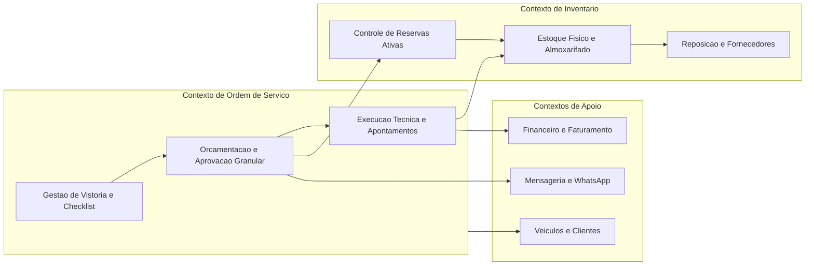
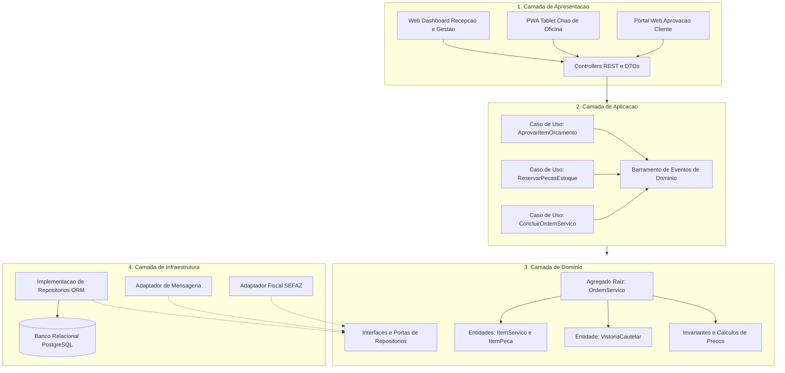
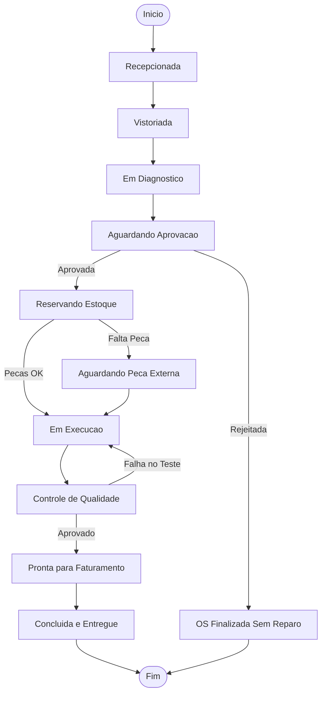

# Trabalho De Reavaliação Crítica e Refinamento Arquitetural
## do Sistema AutoFlow

### Identificação
* **Tema Escolhido:** Sistema de Gestão de Oficinas Mecânicas (AutoFlow)
* **Disciplina:** Arquitetura de Software / Desenvolvimento de Software Corporativo
* **Autor / Integrante:** Pedro Henrique Dias
* **Data:** Setembro de 2026

---

## 1. Guia Executivo de Entregas e Orientações

Em conformidade com as diretrizes da disciplina, os seguintes artefatos compõem a entrega desta etapa de reavaliação crítica:

* **Artefato 1 — Relatório Analítico de Confronto:** Documento técnico contendo a reavaliação crítica das decisões tomadas no Trabalho 1 sob a ótica dos fluxos, entidades, conceitos e estados descobertos no Trabalho 2.
* **Artefato 2 — Matriz Geral de Revisão Arquitetural:** Tabela consolidada que classifica as decisões do Trabalho 1 em Mantida, Refinada, Alterada ou Descartada, justificando cada uma pelo impacto no domínio.
* **Artefato 3 — Diagramas Arquiteturais Revisados:** Versões atualizadas do Diagrama de Módulos (com Bounded Contexts nítidos), Diagrama Arquitetural em Camadas e Diagrama de Estados do Agregado Central (OrdemServico).
* **Artefato 4 — Registro de Incertezas e Questões em Aberto:** Mapeamento explícito das decisões que ainda não possuem evidências suficientes para serem congeladas em nível de arquitetura física ou tecnológica.
* **Forma de Envio:** Arquivo textual em formato Markdown (.md), autocontido e versionável, renderizando diagramas em Mermaid.

---

## 2. Reavaliação Crítica da Proposta Arquitetural Inicial (Trabalho 1 vs. Trabalho 2)

No Trabalho 1, a arquitetura do AutoFlow foi delineada a partir de premissas teóricas genéricas: um Monólito Modular organizado em 4 camadas (Presentation, Application, Domain, Persistence) conectado a um banco de dados relacional (PostgreSQL). 

Com o aprofundamento investigativo do Trabalho 2 (método CeliLac), confrontou-se essa estrutura abstrata com a realidade empírica da esteira de uma oficina mecânica. Emergiram conceitos essenciais — tais como Vistoria Cautelar com Provas Visuais, Aceite Granular por Item, Reserva Atômica versus Baixa Física de Peça, Apontamento de Horas em Box e Transições Críticas de Estado da OS. Essa imersão no domínio forçou revisões estruturais profundas na arquitetura.

### 2.1. O que continua plenamente justificável e se mantém?
* **Adoção do Monólito Modular:** Continua sendo a decisão mais adequada. O Trabalho 2 comprovou a altíssima coesão transacional entre a aprovação do orçamento, a reserva do lote de peças e o bloqueio da agenda do box. Separar o sistema em microsserviços distribuídos nesta fase criaria um problema grave de orquestração de transações e consistência eventual indesejada durante a alocação física de componentes.
* **Arquitetura em Camadas com Inversão de Dependência:** A camada de Domínio deve permanecer isolada de frameworks e mecanismos de banco de dados. O Trabalho 2 deixou explícito que as regras invariantes de negócio (ex.: uma peça aprovada não pode ter seu preço reajustado, nenhum serviço pode ser iniciado sem assinatura prévia do cliente) devem residir no núcleo sem sofrer interferência de bibliotecas externas.

### 2.2. O que precisou ser refinado ou alterado?
* **Decomposição dos Módulos em Bounded Contexts Clássicos:** No Trabalho 1, os módulos de Ordem de Serviço, Orçamento e Estoque foram desenhados como caixas independentes com acoplamento genérico. O Trabalho 2 revelou que a Ordem de Serviço (OS) é na realidade o Agregado Raiz (Aggregate Root) que orquestra o ciclo de vida dos itens orçados. O conceito de Orçamento não é um módulo desconectado, mas sim um estado ou estágio da própria negociação da OS.
* **Tratamento do Estoque (Reserva vs. Consumo Definitivo):** O Trabalho 1 previa apenas a operação genérica de Baixa de Estoque. O Trabalho 2 demonstrou a necessidade de duas operações temporais distintas: 
  1. Reserva Lógica: Bloqueia a quantidade da prateleira no momento do aceite do cliente.
  2. Consumo / Baixa Física Definitiva: Ocorre apenas no encerramento da execução e conferência de saída.
* **Comunicação Assíncrona Orientada a Eventos de Domínio:** A necessidade de desacoplar o fluxo de aprovação do cliente (via link no celular) das ações do mecânico no tablet do box exige uma infraestrutura interna baseada em eventos de domínio (OrcamentoAprovadoEvent, PecaReservadaEvent, ServicoConcluidoEvent).

### 2.3. O que foi categoricamente descartado?
* **Módulo de Diagnóstico Preditivo por IA (AutoPredict AI):** Proposto superficialmente no Trabalho 1, foi descartado na análise crítica por ausência de evidências de viabilidade em oficinas convencionais e por constituir uma antecipação desnecessária de complexidade que não atende às regras invariantes do domínio (Fatos F01 e F02).
* **Reserva Global Antecipada de Peças:** A ideia ingênua de que as peças seriam bloqueadas no momento em que o mecânico insere a lista de defeitos foi descartada. Isso congelaria o inventário para orçamentos que poderiam ser rejeitados pelo cliente. A regra validada determina que a reserva só ocorre mediante o aceite formal.

---

## 3. Matriz Geral de Revisão Arquitetural

A tabela a seguir consolida as alterações das decisões arquiteturais em face das descobertas do domínio:

| Elemento / Decisão Inicial (Trabalho 1) | Nova Compreensão do Domínio (Trabalho 2) | Classificação | Justificativa Arquitetural e Ação de Refinamento |
| :--- | :--- | :--- | :--- |
| **Monólito Modular como estilo inicial** | O fluxo principal de aprovação, alocação de peças e agendamento de boxes exige consistência transacional imediata. | **MANTIDA** | Mantém-se a base monolítica com limites modulares estritos para evitar a sobrecarga de transações distribuídas prematuras. |
| **Módulo de Orçamentos isolado da OS** | O orçamento é uma fase intrínseca da OS; itens de serviço e peças possuem ciclo de vida atrelado ao consentimento do cliente. | **ALTERADA** | O orçamento passa a fazer parte do Bounded Context da Ordem de Serviço, onde a OS é o Agregado Raiz que governa a aprovação de seus itens. |
| **Baixa direta de estoque na abertura da OS** | O cliente pode demorar a aprovar ou aprovar apenas parte dos serviços; peças não podem ser congeladas antecipadamente. | **REFINADA** | Divisão em dois conceitos estruturais: Reserva Temporária (no aceite) e Baixa Definitiva (no encerramento do reparo). |
| **Aprovação binária de orçamento (Tudo ou Nada)** | O cliente frequentemente recusa manutenções secundárias/preventivas para conter custos imediatos (Variação de Negócio). | **REFINADA** | Introdução do padrão de Aprovação Granular por Item, exigindo que o Domínio recalcule subtotais e libere ordens parciais de serviço. |
| **Persistência relacional centrada em tabelas CRUD** | A OS transita por uma máquina de estados complexa (Entrada, Vistoriada, Orçada, Aprovada, Em Execução, Qualidade, Entregue). | **REFINADA** | A persistência agora deve suportar auditoria de transição de estados e eventos de domínio, não apenas atualizações de atributos soltos. |
| **Módulo Preditivo de IA por Áudio** | Não possui sustentação no problema real nem viabilidade técnica para oficinas comuns; desvia o foco da rastreabilidade. | **DESCARTADA** | Removido integralmente do escopo técnico para priorizar confiabilidade operacional e rastreabilidade jurídica. |
| **Checklist como simples anexo textual** | A vistoria inicial com fotos e nível de combustível é a blindagem jurídica da oficina contra contestações de danos pré-existentes. | **ALTERADA** | Promovido a entidade de primeira classe (VistoriaCautelar) com armazenamento imutável de registros visuais e assinatura do cliente. |

---
## 4. Arquitetura Revisada e Diagramas do Sistema

### 4.1. Diagrama de Contextos Delimitados e Módulos Revisados

### 4.2. Diagrama Arquitetural em Camadas Revisado

### 4.3. Diagrama de Estados do Agregado Central (OrdemServico)

## 5. Incertezas Remanescentes e Decisões que Não Podem Ser Tomadas

Mesmo após o aprofundamento do Trabalho 2, persistem pontos de indefinição que não devem ser congelados prematuramente na arquitetura sob risco de retrabalho:

* **Estratégia de Persistência de Mídia das Vistorias:** Não está definido o volume mensal de fotografias de alta resolução geradas nos checklists. Decidir agora se as imagens residirão em armazenamento de objetos local (MinIO), em nuvem pública (Amazon S3) ou em diretório de arquivos é uma decisão técnica precipitada que depende do perfil das oficinas-piloto.
* **Tratamento Operacional e Jurídico de Vícios Ocultos (Questão Q01):** Ainda não há evidência empírica sobre o protocolo legal quando o mecânico constata quebra interna grave após a desmontagem do motor. Isso exigirá decidir se a arquitetura deve suportar uma Ordem Suplementar Vinculada ou a reabertura da OS corrente com preservação do histórico de auditoria.
* **Mecanismo Físico de Sincronização em Rede Instável:** O Trabalho 2 identificou a hipótese H02 (uso de tablets no galpão). Caso o teste de usabilidade em campo aponte queda constante de conectividade no pátio físico, a arquitetura precisará evoluir de uma simples camada web para uma abordagem Offline-First completa baseada em sincronização delta e resolução de conflitos.

---

## 6. Reflexão Crítica e Síntese de Aprendizado

### 6.1. O Impacto do Conhecimento de Domínio sobre a Arquitetura
A experiência acumulada entre os Trabalhos 1 e 2 comprovou na prática um princípio basilar da engenharia de software: arquitetura de software não é sobre tecnologias, linguagens ou bancos de dados, mas sim sobre a capacidade de estruturar soluções que reflitam e protejam as regras e comportamentos do domínio real.

No Trabalho 1, a equipe incorreu no erro comum de antecipar soluções de infraestrutura (PostgreSQL, APIs REST, controllers genéricos) antes de compreender o que realmente importava no chão da oficina. A consequência foi uma arquitetura que tratava o orçamento como algo binário e a baixa de peças como uma operação ingênua. 

O Trabalho 2 desmontou essas premissas superficiais. Ao descobrir que o maior atrito de uma oficina reside no binômio confiança jurídica versus tempo de box ocupado, a arquitetura precisou reorganizar seus limites: o orçamento passou a integrar o núcleo da Ordem de Serviço, a reserva de estoque tornou-se condicional ao aceite granular do cliente, e a vistoria de entrada assumiu papel de primeira grandeza.

### 6.2. Conclusão da Maturidade da Análise
Com essa reavaliação, o sistema AutoFlow deixa para trás diagramas genéricos e assume uma postura arquitetural fundamentada em fatos comprovados e requisitos funcionais reais. As decisões mantidas (Monólito Modular, Camadas com DDD) deixam de ser dogmas teóricos e passam a ser escolhas deliberadas para assegurar integridade transacional, enquanto as incertezas remanescentes permanecem devidamente catalogadas para investigação empírica futura.

---

## Apêndice — Registro do Uso de Inteligência Artificial

* **Ferramenta Utilizada:** Gemini (Google).
* **Finalidade do Uso:** Analista crítico para confrontar premissas arquiteturais do Trabalho 1 com as regras e fluxos de negócio mapeados no Trabalho 2.
* **Principais Contribuições:** Auxiliou na estruturação das transições de estado da Ordem de Serviço, na separação lógica entre reserva e baixa física de estoque, e na depuração da sintaxe Mermaid para compatibilidade com os parsers de Markdown.
* **Sugestões da IA Rejeitadas:** A IA sugeriu inicialmente a inclusão de um módulo preditivo de IA por áudio (AutoPredict AI). A proposta foi rejeitada por Pedro Henrique Dias por ausência de evidências de viabilidade prática em oficinas comuns e para manter o foco na confiabilidade transacional do negócio.
* **Declaração de Autoria e Domínio Técnico:** O autor Pedro Henrique Dias revisou, compreendeu e validou todas as seções deste documento, estando plenamente capacitado a explicar, defender e justificar qualquer fluxo, decisão ou operação aqui apresentada de forma autônoma.