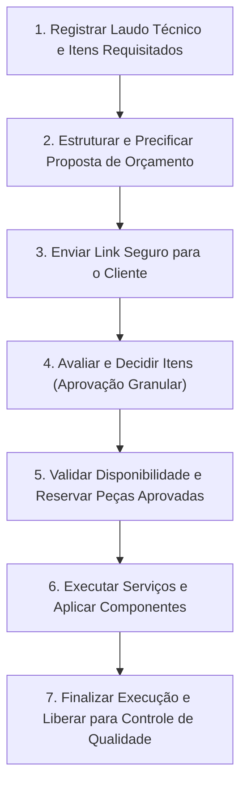

# Trabalho Avaliativo — Análise do Sistema e Domínio do Problema
## Análise Pré-Arquitetural e Investigativa do Sistema AutoFlow

### Identificação
* **Tema Escolhido:** Sistema de Gestão de Oficinas Mecânicas (*AutoFlow*)
* **Disciplina:** Arquitetura de Software / Desenvolvimento de Software Corporativo
* **Autor / Integrante:** Pedro Henrique Dias
* **Data:** Setembro de 2026

---

## ETAPA 1 — Apresentação do Sistema

### 1.1. Nome do Sistema
**AutoFlow** — Plataforma Corporativa de Gestão Operacional e Atendimento para Oficinas Mecânicas.

### 1.2. Problema a Resolver
Oficinas mecânicas automotivas enfrentam gargalos crônicos e atritos decorrentes de fluxos operacionais baseados em pranchetas de papel, anotações informais e comunicação telefônica fragmentada. Esse cenário gera:
* Falta de comprovação do estado físico do veículo na entrada, provocando contestações sobre avarias pré-existentes;
* Orçamentos repassados verbalmente ou por mensagens soltas, que geram desconfiança no consumidor quanto à necessidade real de troca de peças;
* Paralisações e ociosidade no chão de fábrica decorrentes de peças que constam no sistema mas não existem fisicamente na prateleira;
* Falta de rastreabilidade do histórico mecânico, impedindo a fidelização e a manutenção preventiva estruturada.

### 1.3. Contexto de Uso
O problema ocorre no cotidiano dinâmico de oficinas mecânicas independentes e centros automotivos de médio porte, caracterizados por alta rotatividade de veículos, múltiplos boxes físicos de trabalho simultâneos e clientes que exigem transparência técnica, cumprimento estrito de prazos e clareza nos custos envolvidos.

### 1.4. Pessoas e Grupos Afetados
* **Proprietários de Veículos (Clientes):** Sofrem com a falta de clareza nas peças orçadas, custos surpresa ao final do serviço e ausência de previsão do término do reparo.
* **Mecânicos e Técnicos:** Enfrentam retrabalho, interrupções por falta de peças e perda de tempo ao decifrar ordens manuscritas ou laudos incompletos.
* **Recepcionistas e Consultores Técnicos:** Ficam sobrecarregados prestando informações repetitivas por telefone e gerenciando aprovações manuais com clientes.
* **Gerentes de Oficina:** Não conseguem medir a produtividade real por box nem prever a reposição necessária de estoque com base no giro de serviços.

### 1.5. Objetivo Principal da Solução
Criar uma esteira operacional digital e colaborativa que conecte a recepção veicular com vistoria documentada, diagnóstico técnico no box, aprovação remota e transparente de itens orçados pelo cliente, e controle de inventário físico, garantindo rastreabilidade, previsibilidade e segurança jurídica a todas as partes envolvidas.

---

## ETAPA 2 — Quadro de Conhecimento Atual

A tabela a seguir categoriza o entendimento da equipe em **Fatos** (informações confirmadas com evidências), **Hipóteses** (suposições a validar), **Questões em Aberto** (aspectos a investigar) e **Decisões** (escolhas justificadas de negócio).

| ID | Tipo | Descrição | Evidência / Como Validar / Justificativa | Estado |
| :--- | :--- | :--- | :--- | :--- |
| **F01** | **Fato** | A oficina é legalmente proibida de executar qualquer serviço ou substituir peças sem a autorização prévia e expressa do cliente. | Código de Defesa do Consumidor. | Confirmado |
| **F02** | **Fato** | A ausência de registro formal do estado do veículo na chegada gera disputas sobre riscos e amassados pré-existentes. | Relatos operacionais de oficinas e rotinas padrão de vistoria cautelar. | Confirmado |
| **F03** | **Fato** | A execução do reparo fica paralisada se a peça requisitada não estiver disponível no estoque físico nem no distribuidor imediato. | Gargalo físico inescapável no chão de oficina. | Confirmado |
| **F04** | **Fato** | O valor faturado da Ordem de Serviço é composto pela soma da mão de obra (tempo/tabela) com o valor das peças aplicadas. | Prática contábil e operacional padrão do segmento automotivo. | Confirmado |
| **F05** | **Fato** | Um box físico com elevador automotivo só pode acomodar e erguer um veículo por vez. | Restrição física de espaço e infraestrutura mecânica. | Confirmado |
| **H01** | **Hipótese** | Clientes preferem revisar e aprovar orçamentos item a item por um link interativo no celular em vez de ligações telefônicas. | Entrevistar 15 proprietários atendidos no último mês para medir preferência. | Aberta |
| **H02** | **Hipótese** | Mecânicos conseguem registrar laudos técnicos em tablets no chão de fábrica sem perda de tempo produtivo. | Realizar teste piloto de ergonomia e usabilidade durante 1 semana em um box de trabalho. | Aberta |
| **H03** | **Hipótese** | Anexar fotos da peça desgastada ao orçamento aumenta a taxa de aprovação de manutenções preventivas. | Conduzir teste comparativo (com e sem fotos) na taxa de conversão de propostas. | Aberta |
| **H04** | **Hipótese** | Distribuidores locais de autopeças conseguem entregar peças sob demanda na oficina em até 2 horas. | Consultar os acordos de nível de serviço (SLA) e histórico de entregas de 3 fornecedores parceiros. | Aberta |
| **H05** | **Hipótese** | A separação do orçamento entre itens "urgentes" (segurança) e "recomendados" (conveniência) reduz o abandono do orçamento completo. | Acompanhar a métrica de aprovação parcial em 30 ordens consecutivas. | Aberta |
| **Q01** | **Questão** | Qual é o procedimento operacional padrão quando o mecânico encontra um vício oculto grave após já ter desmontado o motor? | Entrevistar chefes de oficina experientes sobre o protocolo de reabertura de diagnóstico. | Aberta |
| **Q02** | **Questão** | Qual o prazo limite de validade de um orçamento antes que o distribuidor reajuste o valor da peça de reposição? | Consultar gerentes de compras e catálogos de fornecedores locais. | Aberta |
| **Q03** | **Questão** | Como a oficina deve proceder legalmente se o cliente reprovar o orçamento, mas demorar dias para retirar o carro que ocupa um box? | Consultar assessoria jurídica e contratos padrão de prestação de serviços mecânicos. | Aberta |
| **D01** | **Decisão** | O orçamento permitirá aprovação e reprovação granular por item individual de peça/serviço. | Evita a rejeição total do serviço quando o cliente discorda apenas de um item de maior custo. | Atual |
| **D02** | **Decisão** | A reserva definitiva da peça no estoque só ocorrerá após o aceite formal do cliente no item respectivo. | Impede o congelamento de estoque físico para propostas que podem ser canceladas pelo cliente. | Atual |

---

## ETAPA 3 — Escolha do Fluxo Principal

### 3.1. Identificação do Fluxo Central
* **Nome do Fluxo:** *Do Diagnóstico Técnico à Execução do Reparo com Aprovação Granular e Reserva de Peças*.
* **Justificativa da Escolha:** Este é o fluxo que gera o valor econômico central da oficina. Ele articula a avaliação técnica do mecânico, a tomada de decisão financeira do proprietário e a logística de peças, sintetizando os principais pontos de fricção do negócio.

### 3.2. Caracterização do Fluxo
* **Objetivo:** Transformar a constatação de um problema mecânico em um conjunto de serviços e peças formalmente aprovados e executados sem gargalos de estoque.
* **Quem Inicia:** O Mecânico / Técnico responsável pelo box.
* **Ponto de Início:** Veículo posicionado no box após o checklist de entrada ter sido finalizado.
* **Resultado Esperado (Conclusão):** Serviços e peças aprovados pelo cliente executados no veículo, estoque devidamente baixado e OS encaminhada para teste de rodagem/faturamento.

## ETAPA 4 — Reconstrução do Fluxo Principal

A sequência cronológica e dependente de etapas do fluxo principal é estruturada conforme o encadeamento a seguir:

---

## ETAPA 5 — Análise das Etapas do Fluxo

| Etapa | Quem Age? | Que Informação Entra? | Que Informação Sai? | Existe uma Decisão? | O que Pode Impedir a Continuidade? |
| :--- | :--- | :--- | :--- | :--- | :--- |
| **1. Diagnóstico Técnico** | Mecânico / Técnico | Veículo posicionado no box, queixa inicial do cliente e checklist de entrada. | Lista de avarias constatadas, peças requeridas e estimativa de horas de mão de obra. | Sim: O defeito é evidente ou exige testes mais profundos com desmontagem prévia? | Mecânico não conseguir reproduzir ou diagnosticar o ruído/falha informado pelo cliente. |
| **2. Estruturação do Orçamento** | Sistema / Consultor | Itens apontados pelo técnico, tabela de horas de mão de obra e preços de tabela de peças. | Proposta de orçamento discriminada com subtotais, prazos e prazo de validade. | Sim: Existem itens de segurança mandatória versus itens de recomendação preventiva? | Peça não cadastrada na base de referência de preços ou tabela de serviços desatualizada. |
| **3. Notificação do Cliente** | Sistema | Número de telefone/e-mail do cliente, link temporário com token seguro de acesso. | Comprovante de entrega da notificação e registro de visualização da proposta. | Não (etapa de despacho operacional). | Número de contato incorreto ou falha de conectividade no canal de mensageria. |
| **4. Avaliação e Decisão** | Cliente / Proprietário | Visualização dos itens orçados, laudos, fotos explicativas e valores individuais. | Registro formal de itens aprovados e itens reprovados pelo cliente. | **Sim:** O cliente aprova todos os itens, aprova apenas alguns ou reprova integralmente a proposta? | Cliente discordar do valor total e não responder dentro do prazo de validade da proposta. |
| **5. Reserva de Peças** | Sistema / Estoquista | Lista de peças exclusivas dos itens aprovados pelo cliente. | Peças marcadas como reservadas para a OS e saldo de estoque livre atualizado. | Sim: Todas as peças aprovadas estão disponíveis em prateleira ou exigem compra externa? | Peça esgotar no intervalo entre a abertura do orçamento e a decisão do cliente. |
| **6. Execução do Reparo** | Mecânico / Técnico | OS em estado de execução, peças reservadas retiradas no balcão e ferramental. | Apontamento de início/fim de cada serviço executado e registro de peças instaladas. | Sim: Foi detectado algum problema adicional durante a desmontagem dos componentes? | Quebra de ferramentas especializadas ou constatação de que a peça nova é incompatível. |
| **7. Finalização Técnica** | Mecânico / Chefe de Oficina | Serviços concluídos e peças velhas acondicionadas para auditoria/devolução. | OS com status "Execução Concluída", liberada para teste de rodagem e faturamento. | Sim: O veículo passou no checklist de qualidade operacional de saída? | Teste de rodagem apontar persistência do problema ou novo ruído. |

---

## ETAPA 6 — Caminho Feliz, Variação e Falha

### 6.1. Fluxo Principal (Caminho Feliz)
1. O mecânico diagnostica desgaste na pastilha de freio e disco dianteiro, inserindo as peças e 1,5 horas de serviço na OS.
2. O sistema gera a proposta no valor de R$ 680,00 e despacha o link via mensagem para o proprietário.
3. O cliente abre a proposta no celular, analisa as fotos do disco desgastado e clica em **"Aprovar Orçamento Completo"**.
4. O sistema valida que as pastilhas e discos estão na prateleira física e efetua a reserva imediata.
5. O técnico retira os componentes no estoque, realiza a substituição, conclui o teste de frenagem e finaliza a OS.

### 6.2. Variação de Negócio (Aprovação Parcial de Itens)
* **Condição de Disparo:** O orçamento apresenta itens urgentes de segurança e itens preventivos secundários, e o cliente possui restrição de orçamento momentânea.
* **Comportamento do Fluxo:**
  1. O orçamento contém: (A) Troca da correia dentada (R$ 850,00 - Urgente) e (B) Troca do filtro de cabine e higienização do ar-condicionado (R$ 180,00 - Preventivo).
  2. O cliente aprova o item (A) e reprova o item (B).
  3. O sistema recalcula automaticamente o total da OS para R$ 850,00, registra formalmente a recusa do item (B) para resguardo de garantia futura e reserva exclusivamente os componentes da correia.
  4. O mecânico recebe no terminal do box a OS atualizada contendo apenas as tarefas aprovadas.

### 6.3. Situação de Falha (Ruptura de Estoque no Momento da Aprovação)
* **Condição de Disparo:** O cliente demora 48 horas para aprovar o orçamento. Nesse intervalo, a última unidade do amortecedor em estoque físico foi alocada para outra OS de emergência já autorizada.
* **Comportamento do Fluxo:**
  1. O cliente clica em "Aprovar Item".
  2. Ao tentar efetuar a reserva, o sistema detecta saldo disponível zero para o componente.
  3. O sistema **não trava o processo nem engana o mecânico**: a OS entra no estado intermediário `Aguardando Chegada de Peça`.
  4. Uma solicitação de compra urgente é enviada automaticamente ao módulo de compras com o fornecedor parceiro.
  5. O cliente e o gerente recebem um aviso com a nova previsão de entrega ajustada para a chegada do componente externo.

---

## ETAPA 7 — Operações Derivadas do Fluxo

A partir da análise do fluxo principal, das variações e das falhas, identificam-se as seguintes operações fundamentais que o sistema precisa ser capaz de executar:

1. `RegistrarDiagnosticoTecnico`: Consolida laudos, fotos de avarias e lista preliminar de peças/serviços vinculados ao veículo.
2. `GerarPropostaOrcamento`: Calcula valores brutos, aplica regras de precificação de mão de obra e gera link seguro com prazo de expiração.
3. `RegistrarDecisaoCliente`: Processa aprovações e recusas item a item e colhe a concordância formal do cliente.
4. `RecalcularOrcamento`: Ajusta valores totais e tempos de execução com base exclusivamente nos itens aprovados.
5. `ReservarItensEstoque`: Transfere a quantidade de peças do saldo livre para o saldo reservado da respectiva OS.
6. `ApontarExecucaoServico`: Registra o início, pausas e encerramento do trabalho mecânico no box.
7. `ConcluirOrdemServico`: Valida se todos os serviços aprovados foram executados e encaminha para faturamento.

---

## ETAPA 8 — Detalhamento de Três Operações

### Operação 1: `RegistrarDecisaoCliente`
| Campo | Descrição e Regras |
| :--- | :--- |
| **Nome** | `RegistrarDecisaoCliente` |
| **Objetivo** | Capturar e registrar formalmente a aprovação ou recusa do proprietário para cada item individual da proposta de orçamento. |
| **Entrada** | Identificador da OS, Token de segurança do acesso, Lista de itens com status individual (`APROVADO` ou `REPROVADO`), Data/Hora da ação. |
| **Processamento** | 1. Valida se o token de acesso corresponde à OS e se está dentro do prazo de validade. 2. Verifica se a OS está no estado `Aguardando Aprovação`. 3. Para cada item marcado como `APROVADO`, confirma a seleção. 4. Para itens marcados como `REPROVADO`, registra a justificativa de não execução para histórico preventivo. 5. Dispara a operação `RecalcularOrcamento`. |
| **Saída** | Proposta atualizada com decisão formal registrada, registro de consentimento digital e evento de autorização despachado para o box. |
| **Regra / Condição** | Pelo menos um item da proposta precisa ser aprovado para que a OS avance para execução; caso todos sejam rejeitados, a OS transita para `Orçamento Reprovado`. |
| **Possível Impedimento** | Token de acesso expirado (tempo limite de validade ultrapassado) ou OS já cancelada previamente pelo atendente. |

### Operação 2: `ReservarItensEstoque`
| Campo | Descrição e Regras |
| :--- | :--- |
| **Nome** | `ReservarItensEstoque` |
| **Objetivo** | Garantir que as peças físicas aprovadas para a OS fiquem vinculadas exclusivamente àquele veículo, impedindo seu uso por outros mecânicos. |
| **Entrada** | Identificador da OS, Lista de códigos de peças aprovadas e respectivas quantidades requisitadas. |
| **Processamento** | 1. Para cada peça da lista, consulta o saldo de estoque físico disponível (`SaldoLivre = SaldoFisico - SaldoJaReservado`). 2. Se `SaldoLivre >= QuantidadeRequisitada`, incrementa o `SaldoJaReservado` e marca o lote da peça como alocado à OS. 3. Se `SaldoLivre < QuantidadeRequisitada`, sinaliza falta de item e gera solicitação de reposição urgente. |
| **Saída** | Registro de peças reservadas vinculado à OS e saldo de estoque livre atualizado no almoxarifado. |
| **Regra / Condição** | Uma peça só pode ser reservada se estiver associada a um item de orçamento com status formal de `APROVADO`. |
| **Possível Impedimento** | Saldo físico insuficiente no armazém no momento exato do processamento. |

### Operação 3: `ConcluirOrdemServico`
| Campo | Descrição e Regras |
| :--- | :--- |
| **Nome** | `ConcluirOrdemServico` |
| **Objetivo** | Encerrar as atividades mecânicas no veículo, confirmar a aplicação definitiva das peças e liberar o carro para entrega e faturamento. |
| **Entrada** | Identificador da OS, Identificador do Mecânico responsável, Quilometragem final, Confirmação do checklist de qualidade/saída. |
| **Processamento** | 1. Verifica se todos os serviços aprovados constam como `Concluídos` pelo técnico. 2. Confirma a baixa definitiva (consumo) das peças que estavam reservadas no estoque. 3. Valida se o checklist de qualidade de saída foi assinado pelo chefe de oficina. 4. Altera o status da OS de `Em Execução` para `Pronta para Retirada`. 5. Desocupa o box físico correspondente no painel de agendamento. |
| **Saída** | OS pronta para faturamento financeiro, box de trabalho liberado para o próximo veículo e aviso de carro pronto enviado ao cliente. |
| **Regra / Condição** | A OS não pode ser concluída se houver qualquer apontamento de serviço aprovado pendente de encerramento. |
| **Possível Impedimento** | Reprovação no checklist de qualidade operacional (ex.: barulho persistente no teste de rodagem exigindo retrabalho). |

---

## ETAPA 9 — Informações Necessárias ao Sistema

Nesta etapa, identificam-se quais conceitos de negócio o sistema precisa conhecer e preservar para que suas operações funcionem, justificando cada um pela sua real necessidade prática (sem modelagem prematura de tabelas ou classes).

* **Histórico do Veículo e Proprietário:**
  * *O que é:* Dados de identificação do carro (placa, chassi, modelo, ano, motorização, quilometragem acumulada) e dados de contato do proprietário.
  * *Por que precisa existir:* Para garantir a rastreabilidade das manutenções ao longo do tempo, identificar a especificação correta de peças de reposição e possibilitar o contato com o cliente.
* **Vistoria / Checklist de Entrada (com Registro Visual):**
  * *O que é:* Registro do estado físico externo/interno do carro na chegada, nível de combustível, estepe, pertences e fotos de avarias pré-existentes.
  * *Por que precisa existir:* Para resguardo jurídico da oficina contra reclamações indevidas de danos que o carro já possuía antes da admissão.
* **Ordem de Serviço (OS):**
  * *O que é:* A entidade central que agrega o ciclo de vida do atendimento (estado atual, box alocado, técnico responsável, data de abertura e prazos).
  * *Por que precisa existir:* Para coordenar todas as ações no chão de oficina, estabelecer prioridades e servir de base para o faturamento e garantia legal.
* **Item de Orçamento / Serviço:**
  * *O que é:* A descrição individual de uma intervenção (mão de obra ou substituição de peça), acompanhada de seu valor unitário, urgência (mandatória/preventiva) e decisão individual do cliente.
  * *Por que precisa existir:* Para permitir a aprovação granular e transparente, documentando exatamente o que foi autorizado e o que foi expressamente recusado pelo cliente.
* **Inventário de Peças e Posição de Reserva:**
  * *O que é:* Catálogo de componentes com saldo físico real em estoque, saldo reservado para ordens em andamento e custo unitário.
  * *Por que precisa existir:* Para impedir que o mesmo componente em estoque seja prometido a múltiplos mecânicos simultaneamente, evitando paralisações operacionais.
* **Apontamento de Execução e Produtividade:**
  * *O que é:* O registro do tempo despendido pelo técnico em cada etapa de montagem e desmontagem.
  * *Por que precisa existir:* Para medir o custo real da mão de obra, calcular a comissão/produtividade da equipe técnica e alimentar tempos médios para orçamentos futuros.

---

## ETAPA 10 — O Que Ainda Não Sabemos?

1. **Quais hipóteses continuam abertas?**
   * A hipótese **H01** (preferência por aprovação digital via celular versus contato telefônico tradicional) permanece como a principal incerteza de usabilidade e depende de entrevistas com clientes de perfis variados (frotistas corporativos versus proprietários particulares).
   * A hipótese **H04** (capacidade dos distribuidores locais suprirem peças em até 2 horas) necessita de validação operacional direta com fornecedores da região.
2. **Qual parte do fluxo apresenta maior incerteza?**
   * A etapa de **diagnóstico de defeitos intermitentes ou ocultos** (ex.: falha elétrica esporádica ou trinca interna de cabeçote), onde o mecânico não consegue definir a lista exata de peças sem antes desmontar partes críticas do motor.
3. **Que informação nova poderia provocar mudanças no fluxo?**
   * A constatação de que frotistas corporativos exigem processos formais de faturamento com ordem de compra vinculada (PO - *Purchase Order*) antes de autorizar qualquer reparo, o que criaria uma variação de fluxo para clientes PJ.
4. **Que decisões técnicas ainda NÃO possuem evidência suficiente para serem tomadas?**
   * A escolha do mecanismo de banco de dados específico, provedores de nuvem e ferramentas de mensageria, uma vez que o volume real de dados de vistorias fotográficas e a concorrência de acessos simultâneos precisam ser mensurados previamente na modelagem de domínio.

---

## ETAPA 11 — Reflexão Crítica do Autor

* **O que a análise esclareceu sobre o sistema que não estava claro inicialmente?**
  * Ficou evidente que o maior desafio de uma oficina mecânica não é apenas emitir uma conta ou registrar peças, mas sim **coordenar a confiança e o tempo**: o cliente teme ser cobrado por peças desnecessárias, enquanto o mecânico teme ter seu trabalho paralisado por falta de componentes físicos. A aprovação granular resolve a confiança; a reserva imediata de estoque resolve o tempo.
* **Qual hipótese apresentou maior risco para o projeto?**
  * A hipótese de que o cliente responderá prontamente ao link de orçamento digital. Se o cliente demorar dias para responder, o carro continuará ocupando espaço físico no galpão, gerando prejuízo operacional para a oficina.
* **Qual questão ainda precisa ser investigada com maior prioridade?**
  * Definir o procedimento jurídico-operacional (**Q01**) para a descoberta de defeitos adicionais durante a desmontagem, garantindo que o orçamento suplementar seja adicionado sem anular a aprovação dos itens anteriores.
* **O que este trabalho mudou na forma de pensar sobre o sistema?**
  * Mudou a perspectiva de "construir um software de cadastros e telas" para "entender a esteira de valor e as regras invariantes de um negócio real". Ficou claro que antecipar tecnologias (como frameworks ou bancos específicos) sem entender o fluxo e as operações do domínio gera sistemas frágeis e desconectados da realidade operacional.
* **O autor se considera preparado para avançar para a Modelagem de Domínio? Por quê?**
  * **Sim.** Porque os limites do problema, os atores, o fluxo central de valor, as condições de falha, as operações essenciais e as informações indispensáveis já foram rigorosamente identificados e justificados sob a ótica de negócio, fornecendo o alicerce necessário para modelar os agregados e entidades na próxima etapa.

---

## Apêndice — Registro do Uso de Inteligência Artificial

* **Ferramenta Utilizada:** Gemini (Google).
* **Finalidade do Uso:** Atuou no papel de analista crítico durante a investigação do problema, auxiliando na identificação de lacunas operacionais, no questionamento de hipóteses implícitas e na estruturação dos caminhos de falha no chão de oficina.
* **Principais Contribuições:**
  * Auxiliou a formular as condições de impedimento e as regras de transição de estado da Ordem de Serviço;
  * Provocou a reflexão sobre o impacto da concorrência física pelo inventário de peças durante o intervalo de decisão do cliente;
  * Estruturou o encadeamento rigoroso de entradas, processamento e saídas para as operações do domínio.
* **Sugestões da IA que Foram Rejeitadas:**
  * A IA sugeriu inicialmente a inclusão de um módulo de diagnóstico preditivo automotivo baseado em análise acústica de áudio por Inteligência Artificial (*AutoPredict AI*).
  * **Justificativa da Rejeição:** A sugestão foi descartada por Pedro Henrique Dias por não possuir evidências de viabilidade prática em oficinas mecânicas convencionais e por desviar o foco da necessidade real do domínio, que reside na consistência das regras de negócio, na vistoria de entrada e na transparência orçamentária.
* **Declaração de Autoria e Domínio Técnico:**
  * O autor (Pedro Henrique Dias) revisou, compreendeu e validou todas as seções deste documento, estando plenamente capacitado a explicar, defender e justificar qualquer fluxo, decisão ou operação aqui apresentada de forma autônoma.
