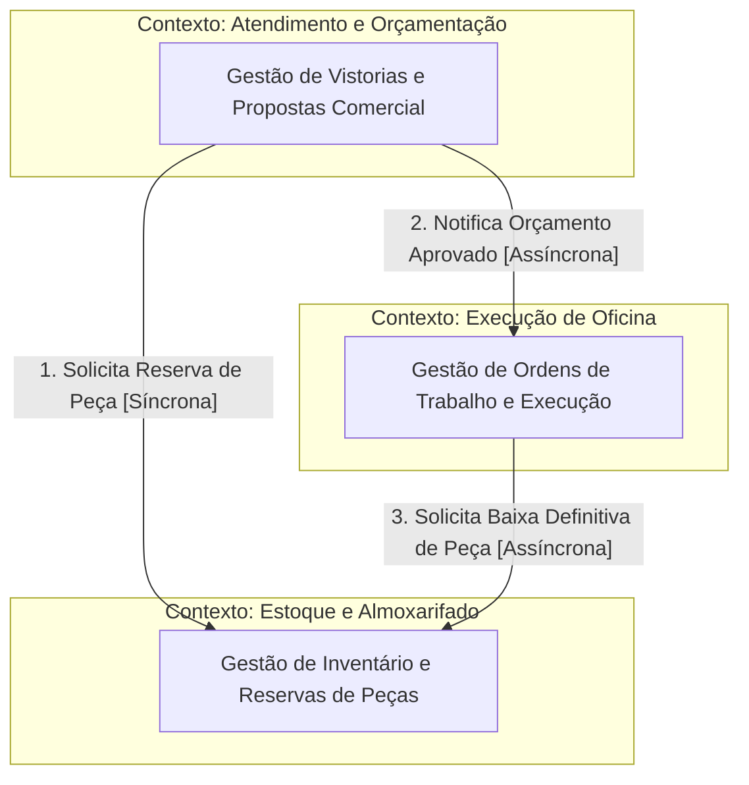

# Do Domínio às Fronteiras: Organizando a Arquitetura do Sistema (AutoFlow)

## Parte 1 — Retomada do Domínio

### Síntese do Sistema AutoFlow
1. **Problema Central:** Ineficiência operacional, falhas de transparência nos orçamentos e risco de litígios jurídicos na gestão de oficinas mecânicas por falta de provas probatórias e controlo rigoroso de peças e mão de obra.
2. **Principais Atores:** Cliente (Proprietário), Recepcionista / Consultor Técnico, Mecânico / Técnico de Reparo e Gerente da Oficina.
3. **Principais Fluxos:** 
   * Admissão e Vistoria Fotográfica de Entrada.
   * Diagnóstico Técnico e Elaboração de Orçamento.
   * Aprovação Granular pelo Cliente.
   * Reserva e Baixa de Peças no Estoque.
   * Execução e Apontamento de Mão de Obra.
   * Faturação e Finalização da Ordem de Serviço (OS).
4. **Conceitos Centrais:** Ordem de Serviço, Vistoria, Proposta de Orçamento, Reserva de Peça, Apontamento de Execução.
5. **Regras de Negócio e Invariantes:**
   * Nenhuma peça ou serviço pode ser executado sem aprovação explícita e registada do cliente.
   * A vistoria de entrada é imutável após a assinatura/confirmação do cliente.
   * Uma peça reserva-se apenas se houver saldo físico disponível no almoxarifado.
6. **Agregados Identificados:** `OrdemDeServico`, `Vistoria`, `Orcamento`, `EstoqueItem`.

### Questão de Análise
> **O que na modelação anterior forneceu pistas para a divisão do sistema em áreas de responsabilidade?**

A análise dos ciclos de vida e dos motivos de mudança revelou fronteiras naturais:
* A **Vistoria** muda por razões de conformidade legal e verificação física no ato da receção.
* O **Orçamento** muda em resposta às negociações comerciais e decisões do cliente.
* A **Reserva de Peças** responde à disponibilidade física de inventário no almoxarifado.
* O **Apontamento de Serviço** responde à produtividade do mecânico e à gestão do tempo na oficina.

Esses ritmos de mudança distintos (*Single Responsibility Principle* ao nível do domínio) indicaram claramente que estes conceitos não deveriam pertencer a um único bloco monolítico de código.

---

## Parte 2 — Descoberta das Áreas de Responsabilidade

### Candidatas a Áreas de Responsabilidade

| Área Candidata | Propósito Principal | Conceitos/Regras Envolvidos |
| :--- | :--- | :--- |
| **Atendimento e Orçamentação** | Registar a entrada da viatura, realizar a vistoria e negociar o orçamento com o cliente. | Vistoria, Proposta, ItemAprovado, Regra de aprovação granular. |
| **Execução de Oficina** | Gerir a fila de trabalho nos elevadores, o progresso do diagnóstico e o tempo dos mecânicos. | ApontamentoTempo, TarefaExecucao, StatusOS, Regra de alocação de box. |
| **Estoque e Almoxarifado** | Assegurar a disponibilidade física de peças e gerir entradas/saídas do inventário. | Peça, Reserva, SaldoDisponivel, Regra de não permitir saldo negativo. |
| **Faturação e Finanças** | Consolidar os valores finais aprovados/executados e processar a liquidação financeira. | Fatura, Pagamento, Comprovativo, Regra de fecho financeiro obriga liquidação. |

### Análise de Consistência
* **Mudança pelo mesmo motivo?** Sim, Atendimento muda com exigências do consumidor; Estoque muda com fornecedores e logística.
* **Proposta claro?** Sim, cada área responde a um momento específico da jornada da oficina.
* **Conceitos possuem atração natural?** Sim, Vistoria atrai Imagem/Avaria; Estoque atrai SKU/Localização na Prateleira.
* **Regras de negócio específicas?** Sim, cada área tem invariantes próprias e isoladas.

---

## Parte 3 — Investigação dos Bounded Contexts

### 1. Contexto: Atendimento e Orçamentação
* **Propósito:** Gerir o relacionamento inicial com o cliente, a receção probatória do veículo e o acordo comercial de serviços/peças.
* **Responsabilidades:** Registar vistoria, emitir orçamento, colher aprovação granular do cliente, gerir dados do proprietário.
* **O que não pertence:** Controlo de quantidade física de peças em prateleiras; registo do cronómetro de reparação do mecânico.
* **Vocabulário:** *Proposta, Vistoria, Item Solicitado, Cliente, Aprovação, Valor Estimado.*
* **Regras e Invariantes:** Itens recusados pelo cliente não podem ser marcados como prontos para execução; a vistoria é imutável após envio.
* **Agregados Relacionados:** `Vistoria`, `Orcamento`.
* **Justificativa da Fronteira:** Isolamento das regras de contacto e aprovação legal do cliente para não impactar a operação técnica da oficina.

### 2. Contexto: Execução de Oficina
* **Propósito:** Coordenar o trabalho operacional dos mecânicos, alocação de postos/elevadores e rastreabilidade da mão de obra.
* **Responsabilidades:** Registar diagnóstico técnico, apontar horas trabalhadas, atualizar o estado de execução das tarefas.
* **O que não pertence:** Negociação de preços com o cliente; processo de faturação/cartão de crédito.
* **Vocabulário:** *Ordem de Trabalho, Apontamento, Mecânico, Box/Elevador, Checklist Técnico.*
* **Regras e Invariantes:** Não é possível iniciar a execução de uma tarefa sem que o item correspondente esteja aprovado e com peça reservada.
* **Agregados Relacionados:** `OrdemDeServico` (na visão de execução).

### 3. Contexto: Estoque e Almoxarifado
* **Propósito:** Garantir a exatidão e o controlo do inventário físico de peças e consumíveis.
* **Responsabilidades:** Reservar peças para reparações aprovadas, dar baixa no inventário físico, alertar sobre níveis mínimos de stock.
* **O que não pertence:** Registo de tempo de reparação; comunicação direta com o cliente final.
* **Vocabulário:** *SKU, Peça, Prateleira, Saldo Disponível, Reserva, Baixa.*
* **Regras e Invariantes:** O saldo disponível não pode ficar negativo; a reserva caduca se a OS for cancelada.
* **Agregados Relacionados:** `EstoqueItem`, `Reserva`.

---

## Parte 4 — Mudanças de Significado entre Contextos

| Conceito | Significado em *Atendimento e Orçamentação* | Significado em *Estoque e Almoxarifado* | Significado em *Execução de Oficina* |
| :--- | :--- | :--- | :--- |
| **Peça** | Item comercial cotado com preço de venda ao cliente final. | Unidade física de inventário associada a um SKU e localização em prateleira. | Componente técnico a ser instalado no veículo durante o procedimento. |
| **Ordem de Serviço (OS)** | Proposta comercial e contrato de autorização assinado pelo cliente. | N/A (Apenas um identificador de referência `osId` para associar a reserva). | Ficha de trabalho técnica composta por tarefas e tempos de execução. |
| **Cliente** | Pessoa jurídica ou física com dados de contacto e histórico financeiro. | N/A (O estoque não precisa de conhecer a identidade do cliente). | Proprietário associado à viatura em reparação (apenas para identificação do veículo). |

> **Conclusão:** Seria um erro arquitetural utilizar o mesmo modelo de dados unificado para todos os contextos. A tentativa de criar uma entidade `Peca` ou `OrdemDeServico` genérica resultaria num modelo acoplado, com atributos nulos em metade dos casos e violação do princípio do menor privilégio/conhecimento.

---

## Parte 5 — Mapa das Fronteiras

## Parte 6 — Conhecimento que atravessa as Fronteiras

### Relato de Fronteira: Atendimento $\rightarrow$ Estoque

1. **Quem inicia a interação?** Contexto de Atendimento e Orçamentação.
2. **Por que a interação é necessária?** Para garantir o bloqueio imediato do item físico no almoxarifado assim que o cliente aprova o orçamento, impedindo que a peça seja vendida a outro cliente.
3. **Quais informações precisam de atravessar a fronteira?** Identificador do item, referência do catálogo (SKU), quantidade autorizada e identificador da OS (`osId`).
4. **Quais informações NÃO deveriam atravessar?** Nome do cliente, dados de contacto, forma de pagamento escolhida ou valor da margem de lucro da peça.
5. **A fronteira consumidora precisa de conhecer detalhes internos do emissor?** Não. O Estoque só precisa do contrato de reserva e do `osId`.
6. **Existe risco de acoplamento desnecessário?** Sim, se o Estoque passasse a validar o estado comercial da OS em vez de apenas aceitar o comando de reserva.
7. **Como a resposta pode ser reduzida?** A resposta limita-se a: `Sucesso (idReserva)` ou `Falha (SemSaldo)`.

---

## Parte 7 — Comunicação entre Fronteiras

| Origem | Destino | Necessidade / Evento | Tipo | Justificativa |
| :--- | :--- | :--- | :--- | :--- |
| **Atendimento** | **Estoque** | Reservar peça imediatamente após aprovação do orçamento. | **Síncrona** | O cliente e o consultor precisam de saber no momento da aprovação se a peça está garantida em stock para libertar o início do trabalho. |
| **Atendimento** | **Execução** | Notificar que a OS foi aprovada e está pronta para o elevador. | **Assíncrona** | O trabalho do mecânico não precisa de arrancar no milissegundo do clique do cliente; basta entrar na fila de trabalho. |
| **Execução** | **Estoque** | Confirmar aplicação da peça e solicitar baixa definitiva. | **Assíncrona** | A baixa física é o encerramento do ciclo do item e pode ser processada em segundo plano. |

---

## Parte 8 — Contratos entre Fronteiras

### Contrato 1: Reserva de Peça Aprovada
* **Origem:** Contexto de Atendimento e Orçamentação
* **Destino:** Contexto de Estoque e Almoxarifado
* **Objetivo:** Bloquear temporariamente ou definitivamente uma quantidade de itens em stock.
* **Informações Enviadas:**
  * `idOrdemServico` (Obrigatório)
  * `codigoReferenciaPeca` (Obrigatório)
  * `quantidadeSolicitada` (Obrigatório)
* **Resultado Esperado:** Confirmação da reserva com `idReserva` ou erro de indisponibilidade física.
* **Semântica Importante:** O campo `quantidadeSolicitada` deve ser um número inteiro estritamente positivo.
* **Possíveis Falhas:** Saldo insuficiente em prateleira; código de peça inexistente.
* **O que NÃO faz parte:** Dados cadastrais do cliente ou preço final de venda.

---

### Contrato 2: Notificação de Orçamento Autorizado
* **Origem:** Contexto de Atendimento e Orçamentação
* **Destino:** Contexto de Execução de Oficina
* **Objetivo:** Notificar o setor técnico de que determinado veículo foi liberado para manutenção.
* **Informações Enviadas:**
  * `idOrdemServico` (Obrigatório)
  * `listaServicosAprovados` (Obrigatório)
  * `placaVeiculo` (Obrigatório)
* **Resultado Esperado:** Criação/Abertura da Ficha de Trabalho na fila da oficina.
* **Semântica Importante:** Contém apenas as tarefas que o cliente efetivamente aprovou.
* **Possíveis Falhas:** OS já cancelada antes do processamento do evento.
* **O que NÃO faz parte:** Condições de pagamento, descontos concedidos ou dados de faturação.

---

## Parte 9 — Teste Crítico das Fronteiras

### Auditoria e Análise de Hipóteses

* **Possui responsabilidades demais?** Inicialmente, o *Atendimento* concentrava a Vistoria e a Faturação Final.
* **Existem Regras de Negócio duplicadas?** Identificou-se o risco de a validação de disponibilidade de peça ser feita tanto na interface do Atendimento como no Estoque.
* **Decisão de Revisão:** 
  * **Hipótese Inicial:** O Atendimento geria a consulta de preços e saldos diretamente na base de dados de stock.
  * **Problema Identificado:** Duplicação de lógica de cálculo de saldo disponível.
  * **Decisão de Revisão:** Toda a inteligência de verificação de saldo e regras de reserva foi isolada exclusivamente no contexto de *Estoque e Almoxarifado*.

---

## Parte 10 — Monólito Modular ou Distribuição?

### Decisão Architectural: Monólito Modular

1. **Maturidade das Fronteiras:** As fronteiras do domínio AutoFlow estão bem delimitadas concetualmente, mas a equipa e o negócio ainda estão em fase de validação das regras operacionais.
2. **Tamanho da Equipa:** A equipa de desenvolvimento é pequena, o que torna a gestão de múltiplos ambientes de *deploy*, pipelines CI/CD e monitorização distribuída desnecessariamente dispendiosa.
3. **Complexidade Operacional:** A introdução de microserviços traria problemas de consistência eventual complexos para um cenário onde um *monólito modular* (com limites claros via módulos/pacotes de código e isolamento de dados) garante consistência transacional direta e simplicidade.
4. **Conclusão:** O sistema AutoFlow será implementado como um **Monólito Modular**, onde cada Bounded Context representa um módulo isolado no mesmo repositório e processo, comunicando por interfaces explícitas.

---

## Parte 11 — Hipótese de Evolução Arquitetural

$$\text{Monólito Modular} \xrightarrow{\text{Crescimento de Volume}} \text{Extracção do Serviço de Estoque} \xrightarrow{\text{Integração de Parceiros}} \text{Arquitetura Orientada a Eventos (EDA)}$$

* **Transição 1 (Monólito Modular $\rightarrow$ Extracção do Estoque):**
  * *O que mudaria:* O contexto de *Estoque e Almoxarifado* passa a ser um microserviço independente.
  * *Qual problema justificaria:* A necessidade de integração com múltiplos fornecedores externos em tempo real e consultas frequentes de catálogo por aplicações móveis.
  * *Riscos Introduzidos:* Latência de rede nas chamadas de reserva e necessidade de gerir falhas de comunicação (*circuit breakers*).

---

## Parte 12 — Decisão Arquitetural (ADR)

### Decisão: Adoção do Padrão Monólito Modular com Comunicação Interna Isolada

* **Contexto:** Necessidade de estruturar a arquitetura do AutoFlow garantindo fronteiras limpas sem introduzir a complexidade operacional de microserviços.
* **Decisão Adotada:** Implementar o AutoFlow como um **Monólito Modular**, onde cada Bounded Context possui o seu próprio pacote/módulo isolado e restrições rígidas de dependência (sem acesso direto às tabelas de outro módulo).
* **Justificativa:** Reduz a complexidade de *deploy* e infraestrutura, mantendo a facilidade de refatoração enquanto as regras de negócio amadurecem.
* **Alternativas Consideradas:** Microserviços desde o dia zero (rejeitado por sobrecusto operacional) ou Monólito Tradicional Acoplado (rejeitado por alto risco de débitos técnicos).
* **Trade-offs:** Ganha-se simplicidade de testes e velocidade de desenvolvimento; perde-se a capacidade de escalar componentes isoladamente na nuvem.
* **Condições para Revisão:** Atingir uma carga de requisições que justifique escalamento independente ou o crescimento da equipa que exija autonomias de *release* distintas.

---

## Parte 13 — Impacto sobre os Trabalhos Anteriores

### Quadro de Revisões do Domain Model

| Conceito / Elemento | Estado Anterior | Estado Revisto / Posição Atual | Justificativa da Mudança |
| :--- | :--- | :--- | :--- |
| **Entidade `Peca`** | Entidade genérica partilhada por todo o sistema. | Dividida entre `ItemOrcamento` (Atendimento) e `ItemEstoque` (Estoque). | Eliminar acoplamento e permitir campos específicos em cada contexto. |
| **Validação de Stock** | Realizada na camada de apresentação/atendimento. | Transferida para o Contexto de Estoque. | Garantir o encapsulamento da regra de negócio sobre saldos e reservas. |
| **Agregado `OrdemDeServico`** | Agregado gigante ("God Object") que continha vistorias, peças e pagamentos. | Desmembrado: OS permanece como raiz de execução, enquanto Vistoria e Orçamento viram Agregados próprios. | Evitar bloqueios concorrentes na base de dados e melhorar o isolamento de transações. |

---

## Parte 14 — Síntese Crítica

* **Principal mudança/compromisso arquitetural:** A renúncia ao modelo de dados global unificado em favor de modelos concetuais delimitados para cada Bounded Context.
* **Fronteira mais difícil de definir:** A fronteira entre *Atendimento* e *Execução de Oficina*, no ponto exato em que a aprovação do orçamento se transforma em ordens de trabalho operacionais.
* **Onde há mais acoplamento?** Na chamada síncrona de reserva de peças entre Atendimento e Estoque, assumida deliberadamente para evitar vender peças inexistentes.
* **Maior incerteza da equipa:** O momento exato em que a empresa necessitará de separar os bancos de dados fisicamente.
* **Evidência futura para alterar a arquitetura:** O aumento no tempo de resposta das transações de reserva ou picos de tráfego exclusivo na consulta de stock durante campanhas promocionais.
* **Decisão consciente de NÃO distribuir:** Optou-se por não utilizar microserviços neste momento para manter a agilidade de desenvolvimento e reduzir falhas de infraestrutura.
* **Contribuição dos trabalhos anteriores:** Os mapeamentos de atores, casos de uso e agregações anteriores foram fundamentais para evitar suposições teóricas e fundamentar cada fronteira na operação real de uma oficina mecânica.