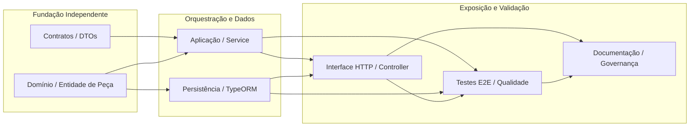

# Caso de Uso Escolhido

## Cadastrar Peça

### UC12 — Unidades de Trabalho

| Unidade de Trabalho | Descrição |
|---|---|
| **Domínio** | Criar entidade de domínio de peça. |
| **Contratos** | Criar DTOs e contratos de entrada e saída. |
| **Aplicação** | Implementar o serviço de cadastro de peças. |
| **Persistência** | Implementar repositório e configurar persistência. |
| **Interface HTTP** | Criar um endpoint POST no controller. |
| **Regras** | Implementar as validações do negócio de peças. |
| **Qualidade** | Implementar os testes automatizados. |
| **Documentação** | Atualizar o histórico de governança. |

---

## Versão em checklist

- [ ] **Domínio** — Criar entidade de domínio de peça.
- [ ] **Contratos** — Criar DTOs e contratos de entrada e saída.
- [ ] **Aplicação** — Implementar o serviço de cadastro de peças.
- [ ] **Persistência** — Implementar repositório e configurar persistência.
- **Interface HTTP** — Criar um endpoint POST no controller.
- [ ] **Regras** — Implementar as validações do negócio de peças.
- [ ] **Qualidade** — Implementar os testes automatizados.
- [ ] **Documentação** — Atualizar o histórico de governança.


# Análise de Dependências entre Atividades (Peer Instruction)

## 1. Questão e Resposta Adequada

**Pergunta:** Todas as atividades podem começar ao mesmo tempo? Dividir um caso de uso não significa que as tarefas sejam independentes: uma atividade pode precisar de contratos, definições ou resultados de outra. Qual afirmação é mais adequada?

- A) Todas as atividades precisam ser executadas em sequência.
- B) Todas podem começar independentemente das demais.
- C) As dependências devem ser identificadas conforme os contratos e a arquitetura do projeto.** *(Alternativa Correta)*
- D) Toda relação entre duas Issues representa uma dependência.

**Justificativa:** A divisão de um Caso de Uso em unidades de trabalho (como contratos, comportamento de domínio, persistência e endpoint) não implica isolamento absoluto nem obriga a uma execução estritamente linear, mas exige que a construção obedeça aos limites arquiteturais e contratuais (por exemplo, um Controller HTTP depende de que o DTO/Contrato e o Serviço de Aplicação estejam definidos para poder delegar chamadas corretamente).

---

## 2. Aplicação ao Projeto AutoFlow (`UC12 - Cadastrar Peça`)

Para implementar o caso de uso **UC12 - Cadastrar Peça**, as atividades seguem um fluxo estruturado de dependências com base na arquitetura limpa e nas diretrizes do projeto:

### Tabela de Mapeamento de Atividades e Dependências

| Atividade / Unidade de Trabalho | Descrição | Depende de | Justificativa |
| :--- | :--- | :--- | :--- |
| **A · Contratos** | Definir DTOs e validações de entrada. | Nenhuma *(Ponto de partida)* | Estabelece o formato dos dados que entram na fronteira HTTP. |
| **B · Domínio** | Criar entidade de domínio de Peça e regras de negócio. | Nenhuma *(Ponto de partida)* | O núcleo de negócio é independente de frameworks e contratos de transporte. |
| **C · Aplicação** | Implementar o Application Service de cadastro. | Contratos, Domínio | Precisa conhecer a entidade de domínio para orquestrar e o DTO para tipar a entrada. |
| **D · Persistência** | Configurar TypeORM, ORM Entity, Migrations e Repositório. | Domínio | O mapeamento relacional e o adaptador precisam refletir os conceitos e invariantes do domínio. |
| **E · Interface HTTP** | Criar endpoint `POST /parts` no Controller. | Contratos, Aplicação | O Controller utiliza os DTOs de contrato e delega a execução ao serviço de aplicação. |
| **F · Qualidade** | Implementar testes automatizados E2E e unitários. | Aplicação, Persistência, HTTP | Os testes validam o comportamento de ponta a ponta cruzando todas as camadas integradas. |
| **G · Documentação** | Atualizar documentação e histórico de governança. | Todas as anteriores | Consolida as decisões arquiteturais, especificações e estado real do repositório. |

---

## 3. Diagrama de Dependências (Mermaid)




# Estrutura de Issue Principal e Sub-Issues (GitHub)

## Issue Principal

**Título:** `[UC12] Cadastrar Peça`  
**Descrição:** Implementar o comportamento completo de cadastro de peças no sistema AutoFlow, garantindo a validação de regras de negócio (código único, nome obrigatório, quantidade em estoque e preço válido), persistência relacional e exposição via interface HTTP.

---

## Sub-Issues Vinculadas

### 1. Sub-Issue: Domínio
- **Título:** `feat(domain): definir entidade Part e invariantes de negócio`
- **Descrição:** Criar a classe de domínio `Part` com seus identificadores, propriedades (código, nome, preço, estoque), métodos de comportamento e validação de invariantes.
- **Vínculo:** Parent `#UC12`

### 2. Sub-Issue: Contratos (DTOs)
- **Título:** `feat(api): criar DTOs de entrada e saída para cadastro de peça`
- **Descrição:** Definir DTOs com validações sintáticas (`class-validator`) para os dados de criação de peça (`CreatePartDto`) e contratos de resposta.
- **Vínculo:** Parent `#UC12`

### 3. Sub-Issue: Serviço de Aplicação
- **Título:** `feat(application): implementar serviço de aplicação CreatePartUseCase`
- **Descrição:** Construir o serviço responsável por orquestrar a verificação de duplicidade, chamada às regras da entidade e persistência via porta do repositório.
- **Vínculo:** Parent `#UC12`

### 4. Sub-Issue: Persistência
- **Título:** `feat(infra): implementar repositório TypeORM, ORM Entity e Migration para Peça`
- **Descrição:** Configurar o mapeamento `PartOrmEntity`, criar a migration de tabela no PostgreSQL e implementar o repositório concreto `PartTypeOrmRepository`.
- **Vínculo:** Parent `#UC12`

### 5. Sub-Issue: Interface HTTP
- **Título:** `feat(api): expor endpoint POST /parts no Controller`
- **Descrição:** Criar a rota no `PartController` para receber a requisição HTTP, acionar os Pipes de validação do NestJS e delegar ao Use Case de aplicação.
- **Vínculo:** Parent `#UC12`

### 6. Sub-Issue: Qualidade e Testes
- **Título:** `test(e2e): implementar testes automatizados de integração e persistência`
- **Descrição:** Escrever testes unitários para o domínio/serviço e testes E2E com PostgreSQL real para validar requisições `POST /parts` com cenários de sucesso e falha.
- **Vínculo:** Parent `#UC12`

---

## Diagrama de Organização Hierárquica (Mermaid)

```mermaid
flowchart TD
    UC12["[UC12] Cadastrar Peça (Issue Principal)"]

    SUB1["#1 Definir modelo Part (Domínio)"]
    SUB2["#2 Criar DTO de cadastro (Contratos)"]
    SUB3["#3 Implementar serviço de cadastro (Aplicação)"]
    SUB4["#4 Implementar persistência (TypeORM / DB)"]
    SUB5["#5 Expor endpoint POST /parts (HTTP)"]
    SUB6["#6 Implementar testes automatizados (Qualidade)"]

    UC12 --> SUB1
    UC12 --> SUB2
    UC12 --> SUB3
    UC12 --> SUB4
    UC12 --> SUB5
    UC12 --> SUB6