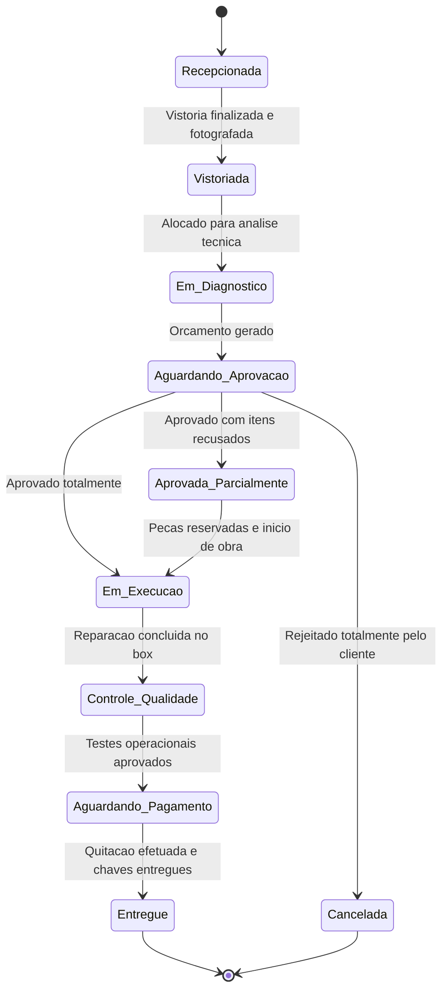
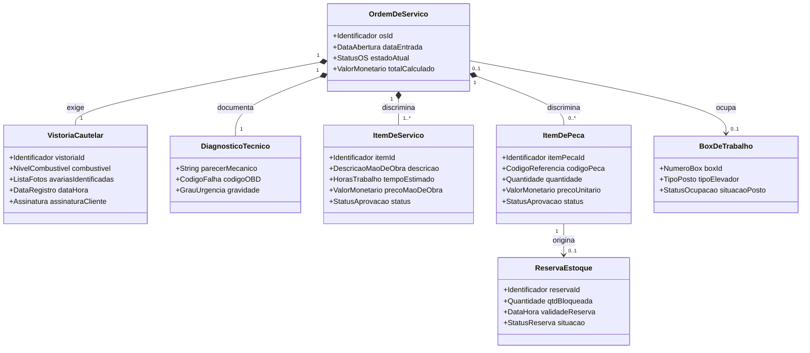

# Modelagem Conceitual do Domínio do Sistema: AutoFlow
**Trabalho: Da Informação ao Domínio — Construindo o Modelo Conceitual do Sistema**

---

## 01. Apresentação e Retomada do Sistema

* **Nome do Sistema:** AutoFlow.
* **Problema Central:** Desorganização no fluxo operacional de oficinas mecânicas multimarcas, caracterizada por falhas de comunicação com os clientes na autorização de orçamentos, perdas financeiras por falta de rastreabilidade de peças, risco jurídico por falta de vistoria formal de entrada e ociosidade de postos de trabalho (boxes) provocada por paradas desnecessárias de veículos.
* **Contexto:** Chão de fábrica de oficinas mecânicas automotivas que realizam manutenção preventiva e corretiva em veículos de passeio e comerciais leves.
* **Atores Principais:** 
  * *Recepcionista / Consultor Técnico:* Efetua o acolhimento do cliente, a vistoria cautelar fotográfica e a abertura da Ordem de Serviço (OS).
  * *Mecânico / Técnico de Reparo:* Executa o diagnóstico, requisita componentes ao almoxarifado e aponta o tempo de mão de obra despendido.
  * *Gerente da Oficina:* Monitora a alocação de boxes de trabalho, gerencia a produtividade e aprova requisições extraordinárias.
  * *Cliente (Proprietário do Veículo):* Analisa, aprova ou rejeita itens de orçamento de forma granular pelo celular e efetua a quitação financeira.
* **Objetivo da Solução:** Fornecer um modelo de gestão operacional baseado no ciclo de vida da Ordem de Serviço, assegurando transparência nas decisões de reparação, rastreabilidade imediata no controle de estoque e segurança jurídica nas entradas e saídas de veículos.
* **Fluxos Mais Importantes:** Ciclo completo de atendimento dividido em: Admissão e Vistoria Cautelar; Diagnóstico Técnico; Elaboração do Orçamento; Decisão Granular do Cliente; Reserva de Componentes; Execução e Apontamento Técnico; Controle de Qualidade e Faturamento com Entrega.
* **Principais Operações:** `AbrirOrdemServico`, `RegistrarVistoriaCautelar`, `RegistrarDiagnosticoTecnico`, `GerarPropostaOrcamento`, `RegistrarDecisaoCliente`, `ReservarItensEstoque`, `ApontarExecucaoServico` e `ConcluirOrdemServico`.
* **Principais Informações Conhecidas/Preservadas:** Dados cadastrais do veículo e proprietário; registro visual (fotografias e nível de combustível) do estado físico na admissão; itens discriminados de serviço e respectivos tempos padrão; catálogo de peças e referências de fabricantes; estado e prazos das reservas de estoque; logs das decisões granulares do cliente com timestamps; histórico de passagens do veículo pela oficina.

---

## 02. Rastreabilidade do Conhecimento Anterior

| Elemento anterior | Descrição resumida | Como influencia a modelagem atual |
| :--- | :--- | :--- |
| **Fluxo Principal (Etapas 1 a 7)** | Sequência de atendimento que vai desde a admissão até a entrega do carro. | Delimita a Ordem de Serviço como o conceito central coordenador e define a sua máquina de estados. |
| **Operação `RegistrarDecisaoCliente`** | Autorização ou recusa de itens de peças e mão de obra de forma isolada. | Exige que itens de serviço e peças possuam ciclo de vida de aprovação próprio e independente. |
| **Informação de Vistoria** | Fotografias, checklist de avarias pré-existentes e nível do tanque. | Torna obrigatória a existência de um elemento de vistoria cautelar para resguardo legal. |
| **Fato F01** | Exigência legal de aprovação prévia de orçamento pelo Código de Defesa do Consumidor. | Estabelece a regra de bloqueio: nenhuma intervenção mecânica pode ocorrer sem o consentimento do cliente. |
| **Fato F02** | A oficina responde por danos não apontados na entrada do veículo. | Condiciona o avanço do atendimento à realização e validação da vistoria física. |
| **Fato F03 / D02** | Falta de peças bloqueia o elevador (box) e atrasa entregas. | Separa o conceito de reserva de peças da baixa contábil definitiva no almoxarifado. |
| **Fato F05** | O número de boxes com elevador é limitado e atende um veículo por vez. | Constrói a restrição de alocação de postos físicos no chão de fábrica. |
| **Hipótese H04** | Atrasos na aprovação do orçamento geram perda de peças para outros serviços. | Justifica o mecanismo de validade temporal das reservas de estoque. |
| **Questão em Aberto Q01** | Procedimento no caso de encontrar defeitos ocultos ao desmontar componentes. | Mantém a incerteza quanto à criação de uma OS suplementar ou à reabertura do orçamento. |
| **Decisão Arquitetural Mantida** | Adoção de arquitetura Monólito Modular. | Requer consistência transacional direta (ACID) entre aprovação, reserva e alocação. |

---

## 03. Candidatos a Conceitos do Domínio

| Conceito candidato | De onde surgiu? | Por que parece relevante? | Grau de certeza |
| :--- | :--- | :--- | :---: |
| **Ordem de Serviço (OS)** | Fluxo principal e Operação `ConcluirOrdemServico` | Centraliza e coordena todo o ciclo de atendimento no chão de fábrica. | **Certeza** |
| **Vistoria Cautelar / Checklist** | Etapa 1 do fluxo e Fato F02 | Resguarda juridicamente a oficina contra queixas de riscos e danos pré-existentes. | **Certeza** |
| **Diagnóstico Técnico** | Operação `RegistrarDiagnosticoTecnico` | Registra a causa raiz identificada e delimita as ações de reparação. | **Certeza** |
| **Item de Serviço** | Etapa 2 do fluxo e Fato F04 | Discrimina a mão de obra individual a ser executada e o tempo orçado. | **Certeza** |
| **Item de Peça** | Etapa 2 do fluxo e Fato F03 | Identifica os componentes físicos e quantidades necessárias para aplicação. | **Certeza** |
| **Proposta de Orçamento** | Operação `GerarPropostaOrcamento` e Fato F01 | Formaliza valores, condições de pagamento e prazos para consulta do cliente. | **Certeza** |
| **Decisão do Cliente** | Operação `RegistrarDecisaoCliente` e Decisão D01 | Registro do consentimento granular (aprovação ou recusa de cada item). | **Certeza** |
| **Reserva de Estoque** | Operação `ReservarItensEstoque` e Decisão D02 | Garante que o material aprovado fica bloqueado exclusivamente para aquela OS. | **Certeza** |
| **Box de Trabalho** | Fato F05 e alocação física da oficina | Representa o posto de trabalho limitado (elevador) onde o carro é assistido. | **Certeza** |
| **Apontamento de Execução** | Operação `ApontarExecucaoServico` | Mede o tempo efetivo de trabalho do mecânico para aferição de produtividade. | **Hipótese** |
| **Histórico do Veículo** | Requisitos de informação preservada | Rastreia intervenções passadas para embasar diagnósticos futuros. | **Certeza** |
| **Solicitação de Compra Urgente** | Tratamento de ruptura de peças e Hipótese H04 | Dispara pedidos a distribuidores locais caso a peça não conste do estoque. | **Hipótese** |
| **Protocolo de Vício Oculto** | Questão em aberto Q01 | Trata o procedimento operacional se uma falha grave surgir após desmontagem. | **Dúvida** |

---

## 04. Investigação de Identidade

| Conceito | Identidade parece relevante? | Evidência / Justificativa | Classificação atual |
| :--- | :---: | :--- | :---: |
| **Ordem de Serviço (OS)** | **Sim** | Dois atendimentos com os mesmos serviços e veículo continuam a ser eventos de negócio distintos no tempo. | Entidade |
| **Vistoria Cautelar** | **Sim** | Constitui uma peça de resguardo probatório única, vinculada pontualmente à entrada de uma viatura específica. | Entidade |
| **Diagnóstico Técnico** | **Não** | Importa o parecer emitido; avaliações idênticas não requerem identidade própria persistente fora da OS. | Objeto de Valor |
| **Item de Serviço** | **Sim** | Sofre alterações de estado individuais (aprovado/recusado) e recebe apontamentos de mão de obra dedicados. | Entidade |
| **Item de Peça** | **Sim** | Possui ciclo de vida de aprovação próprio e comanda reservas físicas pontuais no estoque da oficina. | Entidade |
| **Proposta de Orçamento** | **Não sabemos** | Trata-se de uma fase de consolidação de valores no ciclo da OS, não operando de forma desvinculada. | Processo / Estado |
| **Reserva de Estoque** | **Sim** | Precisa ser rastreada individualmente para controle de expiração e liberação de saldo de armazém. | Entidade |
| **Box de Trabalho** | **Sim** | O elevador físico possui características, agenda de ocupação e histórico de manutenção próprio. | Entidade |
| **Apontamento de Execução** | **Não** | Define-se apenas pelos atributos de medição (instante de início, término e duração do serviço). | Objeto de Valor |

---

## 05. Entidades, Objetos de Valor e Outros Conceitos

| Conceito | Classificação atual | Justificativa | Evidência | Grau de certeza |
| :--- | :--- | :--- | :--- | :---: |
| **Ordem de Serviço** | Provável Entidade | Possui ciclo de vida estruturado e identidade global para o negócio. | Fluxo principal (Etapas 1-7) | Confirmada |
| **Vistoria Cautelar** | Provável Entidade | Necessidade de preservação probatória auditável por razões legais. | Fato F02 e Fotos de Admissão | Confirmada |
| **Item de Serviço** | Provável Entidade | Aprovação granular e execução individualizadas. | Operação `RegistrarDecisaoCliente` | Confirmada |
| **Item de Peça** | Provável Entidade | Controla a reserva e baixa individual do componente na prateleira. | Decisão D02 e Fato F03 | Confirmada |
| **Box de Trabalho** | Provável Entidade | Recurso físico restrito com identificação física e agenda própria. | Fato F05 | Confirmada |
| **Reserva de Estoque** | Provável Entidade | Mantém o bloqueio lógico da quantidade física com prazo de validade. | Operação `ReservarItensEstoque` | Confirmada |
| **Diagnóstico Técnico** | Provável Objeto de Valor | Definido pelo laudo textual do problema e código de falha apurado. | Operação `RegistrarDiagnosticoTecnico` | Confirmada |
| **Apontamento de Execução** | Provável Objeto de Valor | Representa um intervalo temporal imutável de medição de trabalho. | Operação `ApontarExecucaoServico` | Hipótese |
| **Decisão do Cliente** | Outro (Evento de Domínio) | Ocorrência temporal que formaliza o aceite/recusa e dispara reservas. | Decisão D01 | Confirmada |
| **Proposta de Orçamento** | Outro (Estado / Sub-fluxo) | Estágio transitório de composição de preços pertencente à própria OS. | Fato F01 e Etapa 3 | Confirmada |
| **Histórico do Veículo** | Outro (Modelo de Leitura) | Agrupamento de OSs concluídas para consulta de passagens anteriores. | Requisitos de informação | Confirmada |
| **Protocolo de Vício Oculto** | Informação insuficiente | Não há regra fechada sobre gerar uma nova OS ou aditivar a existente. | Questão em aberto Q01 | Dúvida |

---

## 06. Casos de Classificação Ambígua

### Caso 1: Vistoria Cautelar / Checklist
* **Classificação inicialmente considerada:** Objeto de Valor da Ordem de Serviço.
* **Dúvida encontrada:** A vistoria é apenas um conjunto imutável de registros preenchidos na admissão ou possui identidade própria?
* **Alternativas analisadas:** Modelar como um atributo complexo (Value Object) acoplado diretamente à criação da OS ou modelar como Entidade independente.
* **Evidências disponíveis:** A vistoria pode ser retificada na fase de admissão com novas fotografias antes da assinatura e serve como prova jurídica em um eventual litígio civil com o cliente (Fato F02).
* **Classificação atual:** Provável Entidade.
* **Grau de certeza:** Hipótese bem fundamentada.
* **Informação que poderia fazer mudar de ideia:** Se a oficina utilizasse um sistema externo e autônomo de peritagem em que o AutoFlow apenas recebesse um link ou hash do laudo em PDF.

### Caso 2: Itens da Ordem de Serviço (Serviço e Peça)
* **Classificação inicialmente considerada:** Objeto de Valor contido em uma lista dentro da OS.
* **Dúvida encontrada:** Devem ser tratados apenas como linhas de tabela de preços ou possuem identidade própria?
* **Alternativas analisadas:** Manter como lista imutável de itens orçados ou tratar como entidades filhas com identidade local.
* **Evidências disponíveis:** A exigência de Aprovação Granular (Decisão D01) força que cada item transite individualmente de estado (*Pendente*, *Aprovado*, *Recusado*), além de os itens de peça comandarem reservas temporárias de estoque.
* **Classificação atual:** Provável Entidade (com identidade local no agregado).
* **Grau de certeza:** Confirmada.
* **Informação que poderia fazer mudar de ideia:** Se a oficina adotasse um modelo comercial de pacote fechado (ex.: "Revisão dos 30.000 km — preço único e fechado"), onde o cliente apenas aprovasse ou rejeitasse o pacote por inteiro.

---

## 07. Relações Entre Conceitos

| Conceito A | Relação (Verbo) | Conceito B | Significado no domínio | Evidência |
| :--- | :---: | :--- | :--- | :--- |
| **Ordem de Serviço** | **discrimina** | **Item de Serviço** | A OS lista os serviços mecânicos orçados e autorizados para o veículo. | Operação `GerarPropostaOrcamento` |
| **Ordem de Serviço** | **discrimina** | **Item de Peça** | A OS relaciona as peças e consumíveis a serem aplicados no reparo. | Fato F03 e Etapa 2 |
| **Ordem de Serviço** | **exige** | **Vistoria Cautelar** | Nenhuma intervenção começa sem a salvaguarda do estado físico inicial do carro. | Fato F02 (Segurança Jurídica) |
| **Item de Peça** | **origina** | **Reserva de Estoque** | A aprovação do componente pelo cliente bloqueia a unidade física na prateleira. | Operação `ReservarItensEstoque` |
| **Ordem de Serviço** | **ocupa** | **Box de Trabalho** | O carro sob atendimento é alocado em um elevador físico durante a execução. | Fato F05 (Espaço Físico Limitado) |
| **Ordem de Serviço** | **documenta** | **Diagnóstico Técnico** | A OS incorpora a análise do mecânico sobre as causas dos defeitos relatados. | Operação `RegistrarDiagnosticoTecnico` |

---

## 08. Cardinalidades

| Relação | Cardinalidade atual | Evidência | Grau de certeza |
| :--- | :---: | :--- | :---: |
| **Ordem de Serviço discrimina Item de Serviço** | **1 para 1..\*** | Toda OS válida precisa de pelo menos uma intervenção orçada. | Confirmada |
| **Ordem de Serviço discrimina Item de Peça** | **1 para 0..\*** | Podem existir OSs compostas exclusivamente por serviços de mão de obra (ex.: alinhamento). | Confirmada |
| **Ordem de Serviço exige Vistoria Cautelar** | **1 para 1** | Uma OS formal tem exatamente uma vistoria de admissão do veículo. | Confirmada |
| **Item de Peça origina Reserva de Estoque** | **1 para 0..1** | Apenas as peças aprovadas originam reserva temporária ativa no estoque. | Hipótese |
| **Ordem de Serviço ocupa Box de Trabalho** | **0..1 para 0..1** | A OS só ocupa um box durante a execução física; um box só recebe um veículo de cada vez. | Questão em aberto |

*Nota sobre a incerteza:* A restrição de um carro por box é física, mas a cardinalidade temporal permanece em aberto porque a viatura pode ser removida para o pátio enquanto aguarda a entrega de componentes externos.

---

## 09. Regras de Negócio

| ID | Regra de Negócio | Conceitos envolvidos | Origem / Evidência | Situação |
| :---: | :--- | :--- | :--- | :---: |
| **RN01** | **Quando** o cliente recusar um serviço no orçamento, **é proibido** o mecânico executar o serviço ou aplicar a respectiva peça. | Ordem de Serviço, Decisão do Cliente, Item | Artigos 39 (inciso VI) e 40 do Código de Defesa do Consumidor (Fato F01). | Confirmada |
| **RN02** | **Quando** um item de peça for formalmente aprovado pelo cliente, **é necessário** separar a peça na prateleira na mesma hora (reservar estoque). | Item de Peça, Reserva de Estoque | Prevenção de paralisação do box por ruptura de estoque (Fato F03 / Decisão D02). | Confirmada |
| **RN03** | **Quando** a Ordem de Serviço não estiver quitada financeiramente, **é proibido** liberar o veículo para saída da oficina. | Ordem de Serviço, Faturamento | Procedimento operacional padrão de segurança contra falta de pagamento. | Confirmada |
| **RN04** | **Quando** a vistoria de entrada não estiver concluída com registro de fotos, **é proibido** colocar o veículo no elevador do box. | Vistoria Cautelar, Box de Trabalho, OS | Resguardo jurídico contra reclamações de avarias pré-existentes (Fato F02). | Confirmada |
| **RN05** | **Quando** o prazo de validade da proposta de orçamento expirar sem retorno do cliente, **é necessário** cancelar as reservas de peças associadas. | Proposta de Orçamento, Reserva de Estoque | Desbloqueio do estoque para atendimento a outras reparações (Hipótese H04). | Hipótese |

---

## 10. Invariantes e Proteção da Consistência

| Conceito protegido | Possível invariante | O que poderia violá-la? | Consequência | Evidência |
| :--- | :--- | :--- | :--- | :--- |
| **Ordem de Serviço** | Uma OS em execução deve possuir apenas itens aprovados pelo cliente. | Um mecânico iniciar um serviço que o cliente recusou na proposta. | Violação legal, obrigação de arcar com o custo e retrabalho. | Fato F01 (CDC) |
| **Reserva de Estoque** | A quantidade reservada somada à disponível nunca pode exceder o saldo físico do armazém. | Confirmar duas reservas concorrentes para a mesma peça excedendo o saldo real. | Falsa promessa de entrega e paralisação do elevador no box. | Fato F03 |
| **Box de Trabalho** | Um posto de trabalho físico com elevador não pode comportar mais de um veículo simultaneamente. | Falha de agendamento que aloque duas OSs ativas no mesmo box. | Impossibilidade física no chão de fábrica e confusão logística. | Fato F05 |

---

## 11. Estados e Ciclo de Vida

A **Ordem de Serviço (OS)** é a entidade central cujo ciclo de vida estrutura todo o processo operacional da oficina:

* **Estado Inicial:** `Recepcionada`
* **Estados Intermediários:** `Vistoriada`, `Em_Diagnostico`, `Aguardando_Aprovacao`, `Aprovada_Parcialmente`, `Em_Execucao`, `Controle_Qualidade`, `Aguardando_Pagamento`
* **Estados Finais:** `Entregue` (concluída) ou `Cancelada`
* **Transições Inválidas:** Não é permitido saltar diretamente de `Recepcionada` para `Em_Execucao` (violaria a vistoria cautelar e a aprovação obrigatória do cliente).

    
## 12. Primeiro Modelo Conceitual do Sistema

## 13. Explicação do Modelo Conceitual

* **Conceitos Centrais com Identidade:** A `OrdemDeServico` atua como agregador de todo o fluxo operacional. Os itens de serviço e de peça têm identidades locais, pois respondem individualmente à aprovação granular do cliente e ao controle de consumo. A `VistoriaCautelar` e o `BoxDeTrabalho` possuem identidades próprias devido a exigências de auditoria probatória e limitação do espaço físico, respectivamente.
* **Objetos de Valor:** O `DiagnosticoTecnico` é tratado como objeto de valor associado à OS, por se tratar do parecer imutável de constatação de falhas gerado naquela inspeção.
* **Relações e Cardinalidades Confirmadas:** A relação entre a OS e os seus itens (`1` para `1..*` em serviços e `1` para `0..*` em peças) e a exigência de uma vistoria inicial (`1` para `1`) refletem o cumprimento do fluxo da oficina e as normas legais.
* **Incertezas no Modelo:** A relação `ocupa` com `BoxDeTrabalho` permanece flexível (`0..1` para `0..1`). Durante períodos em que a viatura aguarda peças na prateleira ou autorização do cliente, ela não pode ocupar o elevador físico, sendo deslocada para o pátio.

---

## 14. Evolução do Modelo

| Momento | Alteração realizada | Motivo | Evidência ou descoberta que provocou a mudança |
| :--- | :--- | :--- | :--- |
| **Identificação Inicial** | Orçamento era modelado como entidade separada da OS. | Separação comum em sistemas comerciais genéricos. | Na oficina prática, a cotação é apenas um estado transitório do atendimento. |
| **Investigação de Identidade** | Itens de serviço ganharam identidade própria. | Permitir aprovação granular por item. | Decisão D01 e operação `RegistrarDecisaoCliente`. |
| **Relações** | Vistoria Cautelar foi conectada obrigatoriamente à OS. | Garantir proteção jurídica contra queixas de danos. | Fato F02 e risco de responsabilidade civil da oficina. |
| **Cardinalidades** | Relação com Box de Trabalho passou a prever ausência (`0..1`). | O carro não fica todo o tempo no elevador mecânico. | Fato F05 e gargalo de pátio na espera de materiais. |
| **Regras** | Criação do conceito explícito de Reserva de Estoque temporária. | Separar a aprovação da baixa física real. | Fato F03 e Decisão D02 para evitar furos de estoque. |
| **Modelo Atual** | Consolidação em torno do Agregado OS. | Manter a coerência transacional (Monólito Modular). | Discussão arquitetural do Trabalho 3. |

---

## 15. Revisões Identificadas em Relação aos Documentos Anteriores

| Documento anterior | Revisão identificada | Motivo | Impacto futuro |
| :--- | :--- | :--- | :--- |
| **Trabalho 1 (Arquitetura Inicial)** | Descarte do módulo de IA preditiva por áudio (*AutoPredict AI*). | Inviabilidade de captura de som padronizada em oficina comum e custo desproporcional. | Foco da equipe em consistência operacional em detrimento de recursos supérfluos. |
| **Trabalho 2 (Modelagem Preliminar)** | Descarte da baixa imediata de estoque na geração de orçamento. | O cliente pode recusar o orçamento ou demorar a responder, travando o estoque indevidamente. | Inclusão da entidade `ReservaEstoque` com prazo de expiração dinâmico. |
| **Documento de Operações** | Retificação do escopo da vistoria inicial. | A vistoria foi reconhecida com peso jurídico probatório e não como mera listagem cosmética. | Exigência de fotos obrigatórias e assinatura do cliente na recepção. |

---

## 16. Pendências de Governança

| Item a revisar futuramente | Motivo | Prioridade | Consequência se permanecer desatualizado |
| :--- | :--- | :---: | :--- |
| **Documento de Requisitos (T1/T2)** | Remover qualquer menção à dependência do módulo de inteligência artificial de som. | **Alta** | Discrepância grave entre a especificação teórica e o modelo conceitual em código. |
| **Diagrama C4 de Contexto** | Eliminar o serviço desacoplado de orçamentos e fundi-lo no contexto da Ordem de Serviço. | **Média** | Confusão na definição das fronteiras de agregação do sistema. |
| **Fluxo de Defeitos Ocultos (Q01)** | Formalizar como tratar peças danificadas encontradas durante a desmontagem. | **Média** | Risco de os mecânicos executarem aditivos sem respaldo contratual formal. |

---

## 17. Análise Crítica do Modelo

1. **Qual parte do modelo possui melhor sustentação?** A máquina de estados da Ordem de Serviço e o fluxo de aprovação granular de itens, pois encontram sustentação direta na rotina de oficina e no Código de Defesa do Consumidor.
2. **Qual conceito possui classificação mais incerta?** O `Protocolo de Vício Oculto` (ainda rotulado com informação insuficiente) e a representação de `Vistoria Cautelar` (entre entidade com ciclo curto ou objeto de valor complexo).
3. **Qual relação possui justificativa mais frágil?** A relação entre `ItemDePeca` e fornecedores locais para solicitações de compras urgentes em tempo de execução.
4. **Qual cardinalidade ainda precisa de validação?** A ocupação temporal de `BoxDeTrabalho` (`0..1` para `0..1`), para verificar se vale a pena modelar a movimentação da viatura para vagas de estacionamento/pátio.
5. **Qual regra possui maior impacto sobre o modelo?** A regra **RN01** (proibição legal de mexer em componentes não aprovados previamente pelo cliente), que molda todo o desacoplamento e granularidade dos itens.
6. **Existe alguma decisão baseada principalmente em intuição?** A inferência de que o mecânico apontará os tempos de serviço no posto via tela/tablet em tempo real sem afetar a sua produtividade.
7. **Qual hipótese, se rejeitada, provocaria maior mudança?** A hipótese de aprovação granular item a item; se os clientes acharem o processo confuso e exigirem orçamentos fechados em bloco, a cardinalidade e estados dos itens seriam simplificados.
8. **Que nova informação poderia modificar significativamente o modelo?** Exigências fiscais rígidas que imponham emissão antecipada de notas fiscais eletrônicas parciais durante a entrada de materiais.
9. **Qual parte provavelmente será revisada futuramente?** A gestão das reservas de estoque e a sua sincronização com compras externas sob encomenda.
10. **Existe alguma contradição entre este trabalho e a documentação anterior?** Não. As alterações identificadas em relação aos trabalhos anteriores foram formalmente tratadas como revisões de domínio e devidamente registradas nas pendências de governança.

---

## 18. Reflexão da Equipe

* **O que foi descoberto sobre o sistema que não estava claro anteriormente?** Percebeu-se que o orçamento não constitui um sistema independente, mas uma simples fase transitória da vida da Ordem de Serviço, e que uma simples vistoria de entrada carrega um peso jurídico probatório crítico.
* **Qual conceito foi mais difícil de classificar?** A Vistoria Cautelar, pela discussão em torno de ser tratada como um snapshot fechado (Objeto de Valor) ou como um documento com assinatura e anexos (Entidade).
* **Qual relação exigiu maior discussão?** A amarração de um veículo ao Box de Trabalho, percebendo-se que o vínculo não é estático durante todo o atendimento.
* **Alguma informação inicialmente simples passou a ser reconhecida como Entidade?** O Item de Peça orçado, que antes era uma mera linha de texto descritiva e passou a comandar uma Reserva de Estoque ativa.
* **Algum conceito inicialmente considerado Entidade deixou de parecer necessário?** O módulo de Orçamento em separado e o serviço de diagnóstico preditivo por som (*AutoPredict AI*).
* **Qual regra de negócio mais influenciou o modelo?** A proibição de executar serviços sem autorização prévia por escrito do cliente.
* **A equipe considera o modelo atual suficientemente fundamentado para sustentar as próximas etapas do projeto?** Sim. O modelo afasta-se de preferências técnicas artificiais e espelha as regras práticas, garantindo rastreabilidade sólida para a futura implementação modular do AutoFlow.

