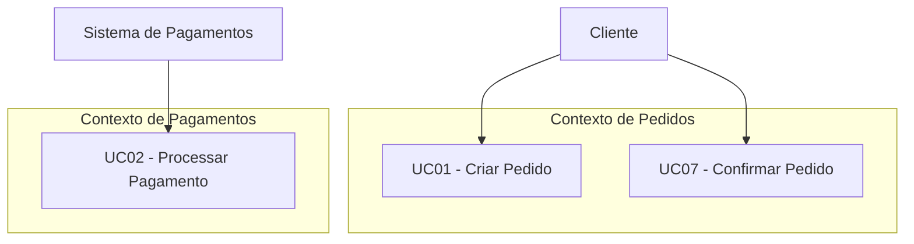
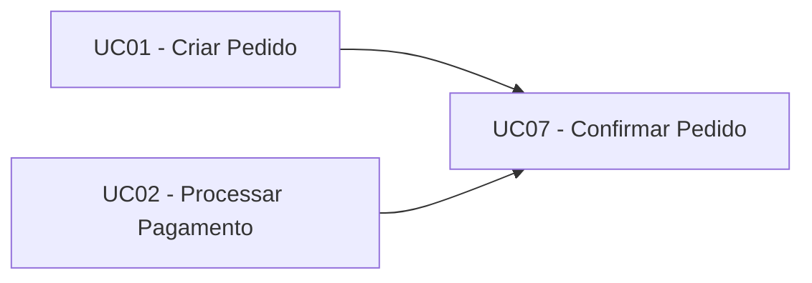
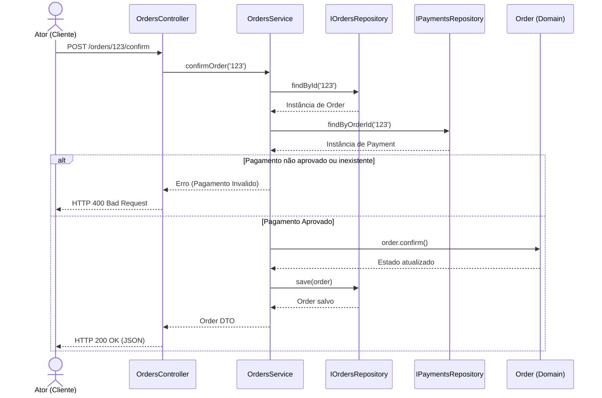
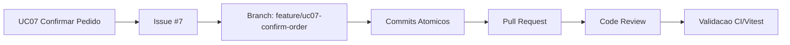

# Blueprint de Implementação do Primeiro Slice do Sistema AutoFlow

---

## 01. Retomada do Sistema

* **Nome do Sistema:** AutoFlow
* **Problema Central:** Ineficiência e falta de rastreabilidade na gestão de pedidos e processamento automatizado de pagamentos em fluxos comerciais e operacionais.
* **Público/Atores Principais:** Cliente, Sistema de Pagamentos (Ator Secundário) e Administrador do Sistema.
* **Objetivo Principal da Solução:** Fornecer uma plataforma centralizada para orquestração automática do ciclo de vida de pedidos, vinculando aprovações financeiras à mudança de estado operacional de forma consistente e desacoplada.
* **Principais Conceitos do Domínio:** Pedido (*Order*), Pagamento (*Payment*), Status do Pedido (*OrderStatus*), Status do Pagamento (*PaymentStatus*).
* **Principais Regras de Negócio:**
  1. Um pedido só pode ser confirmado se houver um pagamento associado aprovado.
  2. Pedidos cancelados ou já confirmados não podem ser reconfirmados.
  3. A confirmação de um pedido registra o instante exato da confirmação (`confirmedAt`).
* **Principais Decisões Arquiteturais:**
  * Clean Architecture com separação em Domain, Application/Service, Controller e Repositories.
  * Inversão de dependência através de interfaces de repositório no núcleo da aplicação.
  * Framework NestJS no ecossistema Node.js/TypeScript.

---

## 02. Atores e Objetivos

| Ator | Objetivo | Resultado Observável |
| :--- | :--- | :--- |
| **Cliente** | Finalizar e confirmar a compra de um pedido | Pedido alterado para o estado `CONFIRMED` com data de confirmação registrada |
| **Sistema de Pagamentos** *(Secundário)* | Notificar ou disponibilizar o status de aprovação de transações | Transação de pagamento associada com status `APPROVED` |
| **Administrador** | Acompanhar a evolução dos pedidos e intervir se necessário | Relatórios e status atualizados no painel operacional |

---

## 03. Identificação e Revisão dos Casos de Uso

| ID | Caso de Uso | Ator Principal | Objetivo | Resultado Observável | Situação |
| :--- | :--- | :--- | :--- | :--- | :--- |
| **UC01** | Criar Pedido | Cliente | Iniciar uma intenção de compra | Pedido salvo com status `PENDING` | Mantido |
| **UC02** | Processar Pagamento | Sistema de Pagamentos | Registrar o resultado financeiro | Pagamento salvo com status `APPROVED` ou `REJECTED` | Mantido |
| **UC07** | Confirmar Pedido | Cliente | Transicionar o pedido para processamento | Pedido atualizado para `CONFIRMED` | Mantido |

---

## 04. Verificação dos Casos de Uso

| Item Inicialmente Identificado | Classificação Inicial | Classificação Atual | Justificativa |
| :--- | :--- | :--- | :--- |
| Validar Saldo do Cartão | Caso de Uso | Regra de Negócio | É uma verificação/decisão que pertence ao contexto do gateway ou domínio de pagamento, não um objetivo direto do ator. |
| Atualizar `status = CONFIRMED` | Caso de Uso | Operação Interna / Transição de Estado | É uma mutação interna decorrente do Caso de Uso de Confirmação de Pedido. |
| Enviar e-mail de confirmação | Caso de Uso | Requisito Transversal / Efeito Colateral | Ação secundária acionada após o sucesso do fluxo principal. |

---

## 05. Organização por Ator e Contexto



---

## 06. Especificações Funcionais

### Especificação do UC07: Confirmar Pedido

* **Identificação:**
  * **ID:** UC07
  * **Nome:** Confirmar Pedido
  * **Objetivo:** Confirmar a efetivação de um pedido pendente mediante verificação de pagamento aprovado.
  * **Ator Principal:** Cliente
  * **Atores Secundários:** Sistema de Pagamentos
* **Pré-condições:**
  * O pedido deve existir no sistema com status `PENDING`.
  * Deve existir um registro de pagamento associado ao pedido.
* **Pós-condições:**
  * O status do pedido passa para `CONFIRMED`.
  * O campo `confirmedAt` é preenchido com o carimbo de data/hora atual.
* **Fluxo Principal:**
  1. O Cliente solicita a confirmação do pedido informando o `orderId`.
  2. O sistema recupera o pedido correspondente.
  3. O sistema recupera a informação de pagamento associada ao pedido.
  4. O sistema verifica se o pagamento está no estado `APPROVED`.
  5. O sistema executa o comportamento de confirmação na entidade de domínio do pedido.
  6. O sistema persiste o estado atualizado do pedido.
  7. O sistema retorna a confirmação de sucesso para o cliente.
* **Fluxos Alternativos / Falhas:**
  * **FA1 - Pedido Não Encontrado:** Caso o `orderId` não corresponda a nenhum pedido registrado, o sistema interrompe a execução e informa que o pedido não foi localizado.
  * **FA2 - Pagamento Não Encontrado:** Caso não haja registro de pagamento para o pedido, o sistema interrompe a operação informando ausência de pagamento.
  * **FA3 - Pagamento Não Aprovado:** Se o pagamento estiver com status `PENDING` ou `REJECTED`, o sistema recusa a confirmação e mantém o pedido no estado atual.
  * **FA4 - Pedido Já Confirmado ou Inválido:** Se o pedido já estiver no status `CONFIRMED` ou `CANCELLED`, a regra do domínio impede a transição e lança uma exceção de domínio.
* **Regras Relacionadas:**
  * RN01: Somente pagamentos no status `APPROVED` autorizam a confirmação do pedido.
  * RN02: Mutação de estado deve ser realizada via método explícito da entidade (`confirm()`).

---

## 07. Rastreabilidade com o Domínio

| Caso de Uso | Conceitos do Domínio | Regras Relacionadas | Invariantes | Contexto / Responsabilidade |
| :--- | :--- | :--- | :--- | :--- |
| **UC07 - Confirmar Pedido** | `Order`, `Payment`, `OrderStatus`, `PaymentStatus` | RN01, RN02 | Pedido confirmado deve possuir `confirmedAt` não nulo e pagamento obrigatoriamente aprovado. | Gestão de Vendas / Núcleo de Pedidos |

* **Justificativa das Análises Anteriores:** As análises de fluxo de caixa e jornada do cliente demonstraram que o envio do produto sem confirmação financeira gerava prejuízos operacionais.
* **Lacunas Reveladas:** Revelou que o objeto de pedido não pode ter seus atributos alterados diretamente por atribuição (`status = 'CONFIRMED'`), exigindo métodos encapsulados na entidade para proteger os invariantes.

---

## 08. Dependências entre Casos de Uso

| Caso de Uso | Depende de | Tipo de Dependência | Justificativa |
| :--- | :--- | :--- | :--- |
| **UC07 - Confirmar Pedido** | UC01 - Criar Pedido | Estado/Informação | O pedido precisa ter sido criado previamente no estado `PENDING`. |
| **UC07 - Confirmar Pedido** | UC02 - Processar Pagamento | Estado | O pagamento associado precisa ter sido processado e aprovado antes da confirmação. |



---

## 09. Priorização e MVP

| Caso de Uso | Valor Central | Dependências | Risco | Pode ser adiado? | Classificação |
| :--- | :--- | :--- | :--- | :--- | :--- |
| **UC01** | Alto | Nenhuma | Baixo | Não | Central |
| **UC02** | Alto | UC01 | Médio | Não | Central |
| **UC07** | Crítico | UC01, UC02 | Alto | Não | Central (Primeiro Slice) |

---

## 10. Escolha do Primeiro Slice

* **Caso de Uso Escolhido:** UC07 - Confirmar Pedido.
* **Ator com Objetivo:** Cliente.
* **Valor Entregue:** Transiciona a venda da fase de negociação/reserva para a fase de execução operacional garantida por suporte financeiro.
* **Representatividade:** Atravessa todas as camadas arquiteturais (HTTP, Application Service, Regras de Domínio e Portas de Repositório).
* **Conceitos de Domínio Participantes:** `Order`, `Payment`.
* **Escopo do Slice:**
  * **ENTRA NO SLICE:** Recebimento do comando via rota HTTP POST, validação de existência, consulta de estado de pagamento via contrato de repositório, execução do método do domínio `confirm()`, e persistência do pedido.
  * **NÃO ENTRA NO SLICE:** Notificações por e-mail, integração com gateway externo em tempo real, geração de nota fiscal e emissão de eventos para mensageria.

---

## 11. Linguagem Ubíqua do Slice

| Termo | Significado no Sistema | Termos que NÃO devem ser usados como sinônimo |
| :--- | :--- | :--- |
| **Order (Pedido)** | Entidade principal que representa a transação de compra. | *Cart, Draft, Checkout* |
| **Confirm (Confirmar)** | Ação de transição de estado que valida o pedido e registra a data de confirmação. | *Update, Save, SetStatus, Pay* |
| **Payment (Pagamento)** | Entidade ou Objeto que representa a transação financeira ligada ao pedido. | *Receipt, Bill, Invoice* |
| **Approved (Aprovado)** | Estado final positivo de uma transação financeira. | *Paid, OK, Done* |

---

## 12. Regra Central e Comportamento do Domínio

* **Regra Central a Proteger:** A confirmação é uma operação exclusiva de pedidos pendentes com pagamentos aprovados.
* **Conceito Guardião:** A entidade `Order`.
* **Transições Válidas:** `PENDING` $\rightarrow$ `CONFIRMED`.
* **Transições Impedidas:** `CONFIRMED` $\rightarrow$ `CONFIRMED`, `CANCELLED` $\rightarrow$ `CONFIRMED`.
* **Expressão Comportamental:**

```typescript
// EVITAR (Atribuição direta frágil):
order.status = 'CONFIRMED';

// PREFERIR (Comportamento encapsulado no Domínio):
order.confirm();
```

---

## 13. Responsabilidades Arquiteturais

| Responsabilidade | Papel Arquitetural | Quem assume no AutoFlow | Justificativa |
| :--- | :--- | :--- | :--- |
| Receber solicitação HTTP | Fronteira | `OrdersController` | Decodifica a rota `POST /orders/:id/confirm` |
| Coordenar Caso de Uso | Aplicação | `OrdersService` | Orquestra a busca nos repositórios e chamada ao domínio |
| Decidir Regra de Negócio | Domínio | Entidade `Order` | Garante a alteração do estado e preenchimento de `confirmedAt` |
| Obter/Persistir informação | Porta / Contrato | `IOrdersRepository`, `IPaymentsRepository` | Abstrai a tecnologia de banco de dados |
| Implementar infraestrutura | Infraestrutura | Mocks / Repositórios Concretos | Provê os dados reais ou simulados |

---

## 14. Modelo Mínimo Necessário ao Slice

* **Entidade `Order`:** Contém `id`, `status`, `totalAmount`, `confirmedAt` e o método `confirm()`.
* **Entidade `Payment`:** Contém `id`, `orderId`, `status` e o método `isApproved()`.
* **Comportamentos Necessários:** `confirm()` na entidade `Order` para validar e alterar estado; `isApproved()` na entidade `Payment` para responder se o pagamento está apto.
* **Fora do Modelo Mínimo:** Endereços de entrega, itens detalhados do pedido, cupons de desconto, histórico de logs de auditoria.

---

## 15. Portas e Dependências Externas

| Porta / Contrato | Necessidade Expressa | Operações Necessárias | Quem Dependerá Dela? |
| :--- | :--- | :--- | :--- |
| `IOrdersRepository` | Obter e salvar estado de pedidos | `findById(id)`, `save(order)` | `OrdersService` |
| `IPaymentsRepository` | Obter o status de pagamento de um pedido | `findByOrderId(orderId)` | `OrdersService` |

---

## 16. Planejamento da Interface HTTP

* **Método:** `POST`
* **Rota:** `/orders/:id/confirm`
* **Parâmetros de Rota:** `id` (string, identificador do pedido)
* **Corpo da Requisição (Body):** Vazio
* **Respostas Esperadas:**
  * `200 OK`: Pedido confirmado com sucesso. Retorna o objeto do pedido atualizado.
  * `400 Bad Request`: Requisição malformada ou transição de domínio inválida (ex: pedido já confirmado).
  * `404 Not Found`: Pedido ou pagamento não localizado.
  * `500 Internal Server Error`: Erro não esperado no servidor.

---

## 17. DTO, Command e Query

* **`ConfirmOrderParamsDto`:** Transporta e valida o parâmetro `id` vindo da requisição HTTP na fronteira do Controller.
* **`ConfirmOrderCommand`:** Representa a intenção explícita de mudança de estado carregando o identificador necessário do ator para a camada de aplicação.
* **Justificativa:** Protege a camada de aplicação de dependências do protocolo HTTP ou estruturas do NestJS.

---

## 18. Planejamento da Persistência

* **Informações a Recuperar:** Estado atual do Pedido por ID; Dados e status da transação de Pagamento associada por `orderId`.
* **Informações a Persistir:** Novo status do Pedido (`CONFIRMED`) e data/hora de confirmação (`confirmedAt`).
* **Isolamento:** A lógica de validação do domínio e a orquestração do serviço permanecem 100% agnósticas de banco de dados, interagindo apenas através das interfaces TypeScript `IOrdersRepository` e `IPaymentsRepository`.

---

## 19. Planejamento de ORM, PostgreSQL e Docker

* **ORM (Prisma ou TypeORM - Futuro):** Resolverá o mapeamento entre objetos do domínio TypeScript e relacional. Permanecerá isolado dentro das implementações concretas dos repositórios na camada de infraestrutura.
* **PostgreSQL (Futuro):** Garantirá a persistência remota, integridade referencial e durabilidade dos dados (ACID).
* **Docker (Futuro):** Garantirá a reprodutibilidade do ambiente de desenvolvimento e produção empacotando a aplicação NestJS e o banco PostgreSQL em containers isolados.

---

## 20. Resultados e Falhas

| Situação | Categoria | Quem Identifica | Significado Interno | Tradução HTTP |
| :--- | :--- | :--- | :--- | :--- |
| Sucesso na confirmação | Sucesso | Domínio / Aplicação | Pedido alterado com sucesso | `200 OK` |
| Pedido não encontrado | Aplicação | `OrdersService` | Entidade não existe na base | `404 Not Found` |
| Pagamento não aprovado | Domínio | `Payment.isApproved()` | Violação de pré-condição financeira | `400 Bad Request` |
| Erro de conexão com banco | Infraestrutura | Repositório Concreto | Falha técnica operacional | `500 Internal Server Error` |

---

## 21. Fluxo Arquitetural Planejado



---

## 22. Blueprint de Implementação

| Ordem | Passo | Objetivo | Dependência |
| :--- | :--- | :--- | :--- |
| **1** | Consolidar Caso de Uso | Especificar pré/pós condições e fluxos do UC07 | Nenhuma |
| **2** | Refinar Domínio Mínimo | Implementar entidades `Order` e `Payment` com métodos comportamentais | Passo 1 |
| **3** | Definir Portas | Criar interfaces `IOrdersRepository` e `IPaymentsRepository` | Passo 2 |
| **4** | Criar Serviço de Aplicação | Implementar `OrdersService.confirmOrder()` orquestrando as portas | Passo 3 |
| **5** | Planejar Interface HTTP | Criar `OrdersController` mapeando a rota `POST` | Passo 4 |
| **6** | Implementar Mocks/Infra | Criar provedores mockados em `OrdersModule` para validação rápida | Passo 5 |
| **7** | Planejar Validação | Criar e executar suíte de testes unitários com Vitest | Passo 6 |

---

## 23. Planejamento de Validação

* **Cenário de Sucesso:** Teste enviando pedido `123` com pagamento aprovado; verificar se o retorno traz status `CONFIRMED` e `confirmedAt` preenchido.
* **Validação de Domínio:** Garantir que chamar `.confirm()` em um pedido sem pagamento aprovado dispara exceção interna.
* **Validação na Aplicação:** Verificar se o serviço dispara erro ao receber IDs inexistentes.
* **Validação da Interface HTTP:** Teste de integração via comando `Invoke-RestMethod` no terminal validando os códigos de status HTTP (`200`, `400`, `500`).

---

## 24. Governança Futura da Implementação



* **Rastreabilidade:** Cada commit deve fazer referência à issue correspondente (`feat: finaliza implementacao do UC07 confirmOrder`).
* **Aprovação:** Merges na branch `main` exigem validação prévia de testes em ambiente automatizado.

---

## 25. Revisões Descobertas nesta Atividade

| Conhecimento Anterior | Descoberta Atual | Revisão Necessária | Impacto |
| :--- | :--- | :--- | :--- |
| Mocks de módulos podiam retornar objetos literais puros `{}` | O NestJS e os serviços esperam métodos de classe operacionais | Atualizar provedores do `OrdersModule` com funções anexas (`confirm()`, `isApproved()`) | Média (Corrigiu erro 500 na API) |
| Repositório remoto no GitHub sincronizava diretamente | Repositórios iniciados com README causam divergência de histórico | Utilizar `--allow-unrelated-histories` e resolver conflitos no Git | Baixa (Apenas governança Git) |

---

## 26. Pendências de Governança

| Artefato/Documento | Alteração Necessária | Motivo | Prioridade |
| :--- | :--- | :--- | :--- |
| Diagrama ER / Modelo Relacional | Adicionar campo `confirmed_at` na tabela de pedidos | Alinhamento com a entidade de domínio | Alta |
| Swagger / Documentação OpenAPI | Registrar respostas de erro 400 e 404 para a rota de confirmação | Transparência para integração do frontend | Média |

---

## 27. Reflexão Crítica

1. **O Caso de Uso selecionado representa valor real para o ator?**  
   Sim, é o marco de consolidação da transação comercial para o cliente.
2. **O comportamento continuaria fazendo sentido sem HTTP?**  
   Sim, o método `confirmOrder()` poderia ser acionado via CLI, fila de mensageria (RabbitMQ/Kafka) ou tarefas agendadas.
3. **Qual é a principal Regra de Negócio do slice?**  
   Um pedido só é confirmado se o pagamento associado estiver aprovado.
4. **Quem deverá protegê-la?**  
   A entidade de domínio `Order` em conjunto com a validação de estado da entidade `Payment`.
5. **Qual parte deverá apenas coordenar?**  
   O `OrdersService`.
6. **Que dependências externas serão necessárias?**  
   Nenhuma obrigatoriedade imediata além da persistência dos dados de pedido e pagamento.
7. **Algum artefato técnico inicialmente imaginado mostrou-se desnecessário?**  
   Sim, a criação de tabelas físicas no PostgreSQL e configurações de ORM/Docker foram postergadas sem prejuízo do funcionamento do slice.
8. **Alguma responsabilidade estava posicionada incorretamente?**  
   Inicialmente, a verificação de status do pagamento tendia a ser colocada no Controller, mas foi corretamente movida para o Application Service/Domínio.
9. **Qual falha foi mais difícil de classificar?**  
   A exceção de servidor (HTTP 500) gerada por falta de métodos no objeto mock, que se situava na fronteira de configuração de infraestrutura do NestJS.
10. **A persistência influenciou indevidamente o modelo em algum momento?**  
    Não, o modelo foi desenhado utilizando conceitos de orientação a objetos limpos e abstratos.
11. **O que este trabalho revelou que a modelagem anterior ainda não mostrava?**  
    A necessidade explícita de métodos comportamentais dentro das entidades mockadas no módulo principal da aplicação.
12. **Que documentação anterior deverá ser revisada?**  
    O documento de arquitetura referente ao módulo de testes e os contratos de repositório.
13. **A equipe considera o blueprint suficientemente claro para orientar uma implementação futura? Por quê?**  
    Sim, pois cobre desde o objetivo de negócio e mapeamento do domínio até a estratégia de testes, erros e governança do código no repositório.

---

## 28. Apêndice - Uso de IA

* **Ferramenta Utilizada:** Gemini (Google).
* **Finalidade:** Auxílio no diagnóstico de erros no servidor NestJS, apoio no processo de sincronização e resolução de conflitos de histórico no Git, e estruturação do documento Markdown de acordo com o Blueprint do Primeiro Slice.
* **Principais Contribuições:**
  1. Identificação da causa raiz do erro HTTP 500 no endpoint de confirmação.
  2. Fornecimento dos comandos do Git PowerShell para superação do erro de histórias não relacionadas (`--allow-unrelated-histories`).
* **Avaliação Crítica:** A IA facilitou o diagnóstico rápido de erros em tempo de execução e acelerou a formatação do blueprint. Todas as sugestões de código e fluxo foram testadas, validadas e compreendidas diretamente no ambiente de desenvolvimento local.