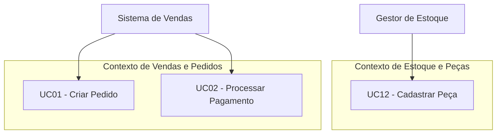
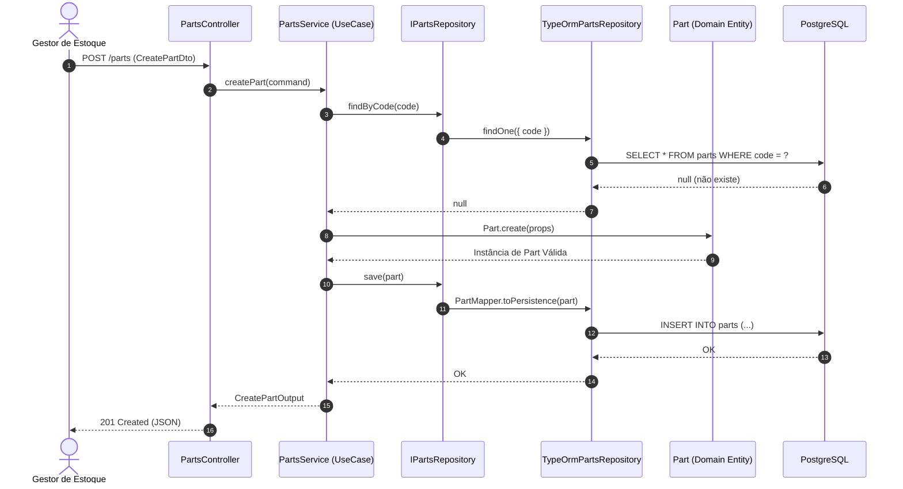
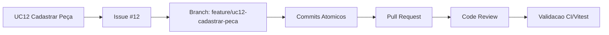

# Blueprint de Implementação do Primeiro Slice do Sistema AutoFlow

## 01. Retomada do Sistema

* **Nome do Sistema:** AutoFlow

* **Problema Central:** Ineficiência, falha na gestão de inventário e ausência de rastreabilidade no cadastro, categorização e controle operacional de peças automotivas/industriais.

* **Público/Atores Principais:** Gestor de Estoque / Almoxarife (Ator Principal), Administrador do Sistema e Sistema de Vendas (Ator Secundário).

* **Objetivo Principal da Solução:** Fornecer uma plataforma centralizada para orquestração automática do fluxo operacional de estoque e peças, garantindo consistência no cadastro de componentes, validação de regras de unicidade e controle de peças no catálogo.

* **Principais Conceitos do Domínio:** Peça (*Part*), Código da Peça (*PartCode* / SKU), Categoria (*Category*), Preço Unitário (*Price*), Quantidade em Estoque (*StockQuantity*).

* **Principais Regras de Negócio:**

  1. Cada peça deve possuir um código identificador único (SKU) válido.

  2. Não é permitido cadastrar peças com preço unitário menor ou igual a zero ($ \text{Price} \le 0 $).

  3. A quantidade inicial de estoque não pode ser negativa ($ \text{StockQuantity} \ge 0 $).

  4. Toda peça cadastrada deve obrigatoriamente pertencer a uma categoria válida.

* **Principais Decisões Arquiteturais:**

  * Clean Architecture com segregação rígida em Domínio, Aplicação, Contratos, Interface HTTP e Persistência.

  * Inversão de dependência utilizando contratos/interfaces de repositório no núcleo.

  * Framework NestJS (Node.js/TypeScript) com PostgreSQL via TypeORM e testes automatizados com Vitest.

## 02. Atores e Objetivos

| Ator | Objetivo | Resultado Observável | 
| ----- | ----- | ----- | 
| **Gestor de Estoque / Almoxarife** | Cadastrar novas peças no repositório do sistema | Peça registrada com sucesso, identificada por um código único e pronta para uso | 
| **Administrador** | Consultar e gerenciar categorias e estoque | Catálogo de peças atualizado e relatórios operacionais sincronizados | 
| **Sistema de Vendas** *(Secundário)* | Obter a lista de peças cadastradas e seus saldos de estoque | Disponibilidade de peças para montagem de ordens de serviço/pedidos | 

## 03. Identificação e Revisão dos Casos de Uso

| ID | Caso de Uso | Ator Principal | Objetivo | Resultado Observável | Situação | 
| ----- | ----- | ----- | ----- | ----- | ----- | 
| **UC01** | Criar Pedido | Cliente | Iniciar uma intenção de compra | Pedido salvo com status `PENDING` | Mantido | 
| **UC02** | Processar Pagamento | Sistema de Pagamentos | Registrar o resultado financeiro | Pagamento salvo com status `APPROVED` ou `REJECTED` | Mantido | 
| **UC12** | Cadastrar Peça | Gestor de Estoque | Registrar uma nova peça no catálogo do sistema | Peça criada no sistema com ID e código registrados | **Novo (Primeiro Slice)** | 

## 04. Verificação dos Casos de Uso

| Item Inicialmente Identificado | Classificação Inicial | Classificação Atual | Justificativa | 
| ----- | ----- | ----- | ----- | 
| Validar Formato do SKU | Caso de Uso | Regra de Negócio / Invariante | É uma validação de integridade do domínio do conceito `PartCode`, não um objetivo independente do ator. | 
| Salvar Peça no Banco SQL | Caso de Uso | Operação Interna de Persistência | É um detalhe de infraestrutura executado como consequência do cadastro de peça. | 
| Exibir Tela de Cadastro | Caso de Uso | Interface de Usuário / Tela | Interface de apresentação frontend, não um comportamento do núcleo do backend. | 

## 05. Organização por Ator e Contexto



## 06. Especificações Funcionais

### Especificação do UC12: Cadastrar Peça

* **Identificação:**

  * **ID:** UC12

  * **Nome:** Cadastrar Peça

  * **Objetivo:** Registrar uma nova peça no inventário informando código SKU, nome, preço e estoque inicial.

  * **Ator Principal:** Gestor de Estoque / Almoxarife

  * **Atores Secundários:** N/A

* **Pré-condições:**

  * O Gestor de Estoque deve estar autenticado no sistema com permissão de escrita no módulo de catálogo.

  * A categoria atribuída à peça deve previamente existir no sistema.

* **Pós-condições:**

  * A nova peça é inserida no catálogo com um identificador único (UUID).

  * O código SKU torna-se reservado para evitar duplicidade.

* **Fluxo Principal:**

  1. O Gestor de Estoque solicita o cadastro da peça informando `code`, `name`, `price`, `stockQuantity` e `categoryId`.

  2. O sistema verifica se o código `code` já está em uso por outra peça cadastrada.

  3. O sistema valida as regras de negócio de domínio (preço maior que zero e estoque maior ou igual a zero).

  4. O sistema cria a instância da entidade de domínio `Part`.

  5. O sistema persiste a nova peça na base de dados.

  6. O sistema retorna os dados da peça cadastrada com o código de status HTTP `201 Created`.

* **Fluxos Alternativos / Falhas:**

  * **FA1 - Código SKU Já Existente:** Se o código `code` informado já estiver cadastrado no repositório, o sistema recusa a operação e retorna um erro de conflito (`409 Conflict`).

  * **FA2 - Preço Inválido:** Se o `price` for menor ou igual a zero ($ \text{Price} \le 0 $), a regra do domínio rejeita a criação e dispara uma exceção (`422 Unprocessable Entity`).

  * **FA3 - Estoque Negativo:** Se o `stockQuantity` for menor que zero ($ \text{StockQuantity} < 0 $), o domínio bloqueia a instanciação (`422 Unprocessable Entity`).

  * **FA4 - Dados Obrigatórios Ausentes:** Se algum campo obrigatório for omitido na requisição, a camada de transporte bloqueia antes de atingir a aplicação (`400 Bad Request`).

* **Regras Relacionadas:**

  * **RN01:** O código SKU da peça deve ser único em todo o sistema.

  * **RN02:** O preço da peça deve ser estritamente positivo ($ \text{Price} > 0 $).

  * **RN03:** O estoque inicial não pode ser negativo ($ \text{StockQuantity} \ge 0 $).

## 07. Rastreabilidade com o Domínio

| Caso de Uso | Conceitos do Domínio | Regras Relacionadas | Invariantes | Contexto / Responsabilidade | 
| ----- | ----- | ----- | ----- | ----- | 
| **UC12 - Cadastrar Peça** | `Part`, `PartCode`, `Price`, `StockQuantity` | RN01, RN02, RN03 | Toda peça possui SKU único, preço $> 0$ e quantidade $\ge 0$. | Gestão de Peças e Estoque / Núcleo do Inventário | 

* **Justificativa das Análises Anteriores:** As auditorias de estoque anteriores indicaram erros de faturamento causados por peças cadastradas com valores zerados ou duplicidade de códigos no almoxarifado.

* **Lacunas Reveladas:** Demonstrou-se a necessidade de encapsular o cálculo e validação do preço e SKU dentro de Objetos de Valor e métodos da Entidade `Part`, evitando mutação direta via atributos públicos.

## 08. Dependências entre Casos de Uso

| Caso de Uso | Depende de | Tipo de Dependência | Justificativa | 
| ----- | ----- | ----- | ----- | 
| **UC01 - Criar Pedido** | UC12 - Cadastrar Peça | Estado / Informação | Para incluir itens em um pedido de venda, as peças precisam estar devidamente cadastradas no catálogo. | 


## 09. Priorização e MVP

| Caso de Uso | Valor Central | Dependências | Risco | Pode ser adiado? | Classificação | 
| ----- | ----- | ----- | ----- | ----- | ----- | 
| **UC12** | Crítico | Nenhuma | Baixo | Não | **Central (Primeiro Slice)** | 
| **UC01** | Alto | UC12 | Médio | Sim | Central | 
| **UC02** | Alto | UC01 | Médio | Sim | Central | 

## 10. Escolha do Primeiro Slice e Decomposição em Unidades de Trabalho

* **Caso de Uso Escolhido:** UC12 - Cadastrar Peça.

* **Ator com Objetivo:** Gestor de Estoque / Almoxarife.

* **Valor Entregue:** Permite a estruturação do catálogo base do sistema, viabilizando todas as operações subsequentes de venda e montagem de ordens de serviço.

* **Decomposição do Slice (Decomposição Possível do UC12):**

| Camada / Unidade | Unidade de Trabalho do UC12 | Detalhamento Técnico no Projeto | 
| ----- | ----- | ----- | 
| **Domínio** | Criar entidade `Part` | Encapsula atributos (`id`, `code`, `name`, `price`, `stockQuantity`), invariantes de negócio e construtor de fábrica. | 
| **Contratos** | Criar DTO de cadastro | Mapeia o contrato de entrada `CreatePartDto` com validações via `class-validator` e `CreatePartOutput`. | 
| **Aplicação** | Implementar serviço de cadastro | Classe `CreatePartUseCase` / `PartsService.createPart()` que orquestra a verificação de duplicidade e instanciação. | 
| **Persistência** | Implementar repositório e configurar persistência | Contrato `IPartsRepository`, implementação `TypeOrmPartsRepository`, `PartOrmEntity` e Migration de banco SQL. | 
| **Interface HTTP** | Criar endpoint `POST /parts` | `PartsController` exposto no NestJS para receber requisições HTTP REST. | 
| **Regras** | Implementar validações | Proteção de regras de unicidade de SKU, preço positivo e integridade de schema. | 
| **Qualidade** | Implementar testes automatizados | Testes unitários do domínio (`part.entity.spec.ts`) e testes E2E da API (`parts-create.e2e-spec.ts`) com Vitest. | 
| **Documentação** | Atualizar documentação | Atualização do `README.md`, OpenAPI/Swagger e relatórios de governança do repositório. | 

## 11. Linguagem Ubíqua do Slice

| Termo | Significado no Sistema | Termos que NÃO devem ser usados como sinônimo | 
| ----- | ----- | ----- | 
| **Part (Peça)** | Entidade física ou componente catalogado disponível no estoque. | *Product, Item, Component, Merchandise* | 
| **Code / SKU (Código)** | Identificador alfanumérico único comercial de cada peça. | *Barcode, ID, SerialNumber, Tag* | 
| **StockQuantity (Estoque)** | Quantidade física disponível da peça no armazém. | *Amount, Balance, Count* | 
| **Create (Cadastrar)** | Ação de registrar formalmente uma nova peça no catálogo. | *Insert, Save, Register, Add* | 

## 12. Regra Central e Comportamento do Domínio

* **Regra Central a Proteger:** Uma peça só é criada se possuir preço positivo, código único e quantidade de estoque não negativa.

* **Conceito Guardião:** Entidade de Domínio `Part`.

* **Expressão Comportamental:**

```typescript
// EVITAR (Atribuição direta anêmica):
const part = new Part();
part.price = -10;

// PREFERIR (Comportamento encapsulado via construtor/factory de Domínio):
const part = Part.create({
  code: 'PC-1001',
  name: 'Filtro de Óleo',
  price: 45.90,
  stockQuantity: 10,
  categoryId: 'cat-123'
});
```

## 13. Responsabilidades Arquiteturais

| Responsabilidade | Papel Arquitetural | Quem assume no AutoFlow | Justificativa | 
| ----- | ----- | ----- | ----- | 
| Receber solicitação HTTP | Interface HTTP | `PartsController` | Expõe a rota `POST /parts` e valida payload de entrada. | 
| Coordenar Caso de Uso | Aplicação | `PartsService` / `CreatePartUseCase` | Orquestra busca de duplicidade no repositório e chamada ao domínio. | 
| Decidir Regra de Negócio | Domínio | Entidade `Part` | Garante a integridade dos dados e dispara validações de valores. | 
| Obter/Persistir informação | Contratos / Porta | `IPartsRepository` | Interface que isola a aplicação da tecnologia de banco. | 
| Implementar infraestrutura | Persistência | `TypeOrmPartsRepository` | Executa consultas e gravações relacionais com TypeORM/PostgreSQL. | 

## 14. Modelo Mínimo Necessário ao Slice

* **Entidade `Part`:** Propriedades `id`, `code`, `name`, `price`, `stockQuantity`, `categoryId`, `createdAt`. Métodos: `Part.create()`, `updatePrice()`.

* **Contratos:** `IPartsRepository` (métodos `findByCode(code)` e `save(part)`).

* **Fora do Modelo Mínimo:** Histórico de movimentações de estoque, fornecedores associados, fotos/imagens da peça, especificações técnicas avançadas.

## 15. Portas e Dependências Externas

| Porta / Contrato | Necessidade Expressa | Operações Necessárias | Quem Dependerá Dela? | 
| ----- | ----- | ----- | ----- | 
| `IPartsRepository` | Obter e persistir dados da peça | `findByCode(code: string)`, `save(part: Part)` | `PartsService` / `CreatePartUseCase` | 

## 16. Planejamento da Interface HTTP

* **Método:** `POST`

* **Rota:** `/parts`

* **Corpo da Requisição (Body):**

```json
{
  "code": "PART-2026-X",
  "name": "Vela de Ignição",
  "price": 29.90,
  "stockQuantity": 50,
  "categoryId": "2c62c3e2-8924-4f81-a67b-1188371192e2"
}
```

* **Respostas Esperadas:**

  * `201 Created`: Peça cadastrada com sucesso. Retorna objeto JSON da peça criada.

  * `400 Bad Request`: JSON de entrada inválido ou campos obrigatórios ausentes.

  * `409 Conflict`: Código SKU já cadastrado no sistema.

  * `422 Unprocessable Entity`: Violação de regra de negócio do domínio (ex: preço negativo).

## 17. DTO, Command e Query

* **`CreatePartDto`:** Transporta e aplica decoradores de validação (`@IsNotEmpty()`, `@IsNumber()`, `@IsPositive()`) na entrada HTTP.

* **`CreatePartCommand`:** Representa a intenção de cadastro dentro da camada de aplicação.

* **`CreatePartOutput`:** DTO de saída desacoplado da estrutura da tabela SQL.

## 18. Planejamento da Persistência

* **Informações a Recuperar:** Checagem de existência da peça por código (`code`).

* **Informações a Persistir:** Registro da nova peça com ID UUID, dados cadastrais e carimbo de data/hora (`created_at`).

* **Isolamento:** A entidade de domínio `Part` é convertida para `PartOrmEntity` através de um `PartMapper`, mantendo a camada de negócio limpa de bibliotecas externas.

## 19. Planejamento de ORM, PostgreSQL e Docker

* **TypeORM:** Responsável pelo mapeamento objeto-relacional entre `Part` e a tabela `parts`.

* **PostgreSQL:** Banco de dados relacional garantindo integridade de colunas, chave primária UUID e restrição única no campo `code` (`UNIQUE`).

* **Docker Compose:** Executa a instância do PostgreSQL em ambiente isolado via container (`autoflow-postgres`).

## 20. Resultados e Falhas

| Situação | Categoria | Quem Identifica | Significado Interno | Tradução HTTP | 
| ----- | ----- | ----- | ----- | ----- | 
| Sucesso no Cadastro | Sucesso | Aplicação / Domínio | Peça criada e persistida com sucesso | `201 Created` | 
| Código SKU Duplicado | Regra / Aplicação | `PartsService` / Repositório | Peça com o mesmo código já existe na base | `409 Conflict` | 
| Preço Negativo | Violação de Domínio | Entidade `Part` | Preço informado descumpre regra da entidade | `422 Unprocessable Entity` | 
| Erro de Conexão com Banco | Infraestrutura | Adaptador TypeORM | Falha técnica operacional na camada de dados | `500 Internal Server Error` | 

## 21. Fluxo Arquitetural Planejado



## 22. Blueprint de Implementação

| Ordem | Passo | Objetivo | Dependência | 
| ----- | ----- | ----- | ----- | 
| **1** | Consolidar Caso de Uso | Especificar pré/pós-condições do UC12 | Nenhuma | 
| **2** | Criar Entidade de Domínio | Implementar a classe `Part` com validações | Passo 1 | 
| **3** | Definir Porta do Repositório | Criar a interface `IPartsRepository` | Passo 2 | 
| **4** | Criar Serviço de Aplicação | Implementar `PartsService.createPart()` | Passo 3 | 
| **5** | Planejar Controller e DTO | Criar `PartsController` e `CreatePartDto` | Passo 4 | 
| **6** | Implementar Persistência | Configurar `PartOrmEntity`, Migration e `TypeOrmPartsRepository` | Passo 5 | 
| **7** | Implementar Testes | Criar testes unitários e E2E via Vitest | Passo 6 | 

## 23. Planejamento de Validação

* **Cenário de Sucesso:** Envio de payload válido para `POST /parts`; verificação da resposta `201 Created` e checagem do registro direto no banco PostgreSQL.

* **Validação de Domínio:** Testar a tentativa de instanciação de `Part` com preço zero ou negativo, garantindo que o domínio lança exceção.

* **Validação de Duplicidade:** Tentar cadastrar duas peças com o mesmo `code` e validar o retorno `409 Conflict`.

## 24. Governança Futura da Implementação



## 25. Revisões Descobertas nesta Atividade

| Conhecimento Anterior | Descoberta Atual | Revisão Necessária | Impacto | 
| ----- | ----- | ----- | ----- | 
| O sistema focava unicamente em pedidos | O fluxo de vendas exige o cadastro prévio e gestão do catálogo de peças (UC12) | Atualizar a prioridade do MVP colocando o UC12 como primeiro slice | Alta (Reorientação da entrega inicial) | 

## 26. Pendências de Governança

| Artefato/Documento | Alteração Necessária | Motivo | Prioridade | 
| ----- | ----- | ----- | ----- | 
| Diagrama de Classes de Banco | Adicionar tabela `parts` com restrição `UNIQUE(code)` | Alinhamento com a nova ORM Entity | Alta | 
| Swagger / OpenAPI | Registrar rota `POST /parts` e schemas de erro | Transparência para integração com frontend | Média | 

## 27. Reflexão Crítica

 1. **O Caso de Uso selecionado representa valor real para o ator?**

    Sim, permite ao Gestor de Estoque cadastrar e controlar as peças que sustentam toda a operação comercial.

 2. **O comportamento continuaria fazendo sentido sem HTTP?**

    Sim, o cadastro de peças poderia ser feito via script CLI, importação de arquivo CSV ou mensageria.

 3. **Qual é a principal Regra de Negócio do slice?**

    Unicidade de código SKU e obrigatoriedade de preço positivo.

 4. **Quem deverá protegê-la?**

    A entidade de domínio `Part` (regras numéricas) e a combinação com o `IPartsRepository` (unicidade).

 5. **Qual parte deverá apenas coordenar?**

    O `PartsService`.

 6. **Que dependências externas serão necessárias?**

    Apenas o banco PostgreSQL para garantir a persistência duradoura.

 7. **Algum artefato técnico inicialmente imaginado mostrou-se desnecessário?**

    Sim, gateways de pagamento e integrações complexas de e-mail não foram necessários para este slice.

 8. **Alguma responsabilidade estava posicionada incorretamente?**

    Validações de regras numéricas de peças tendiam a ser colocadas no Controller ou no DTO, mas foram corretamente alocadas no Domínio.

 9. **Qual falha foi mais difícil de classificar?**

    A diferença entre recusa por duplicidade de SKU (`409 Conflict`) e falha de formato de entrada (`400 Bad Request`).

10. **A persistência influenciou indevidamente o modelo em algum momento?**

    Não, a entidade de domínio `Part` permaneceu pura e desvinculada dos decorators do TypeORM através do uso de Mappers.

11. **O que este trabalho revelou que a modelagem anterior ainda não mostrava?**

    A importância de ter um cadastro de peças independente antes de criar o fluxo de ordens de venda.

12. **Que documentação anterior deverá ser revisada?**

    O catálogo de casos de uso e o modelo relacional de banco de dados.

13. **A equipe considera o blueprint suficientemente claro para orientar uma implementação futura? Por quê?**

    Sim, pois realiza a decomposição explícita do UC12 em 8 unidades claras de trabalho técnico (Domínio, Contratos, Aplicação, Persistência, Interface HTTP, Regras, Qualidade e Documentação).

## 28. Apêndice — Uso de IA

* **Ferramenta Utilizada:** Gemini (Google).

* **Finalidade:** Adequação do blueprint para o novo caso de uso de cadastro de peças (UC12) e decomposição do slice conforme a matriz de unidades de trabalho solicitada.

* **Principais Contribuições:** Reformulação completa da arquitetura do documento, geração de novos diagramas Mermaid e estruturação da tabela de decomposição do slice.

* **Avaliação Crítica:** A ferramenta auxiliou na reorganização sintática e coerência estrutural dos fluxos. Todas as decisões de domínio e divisões de camada foram revisadas criticamente.