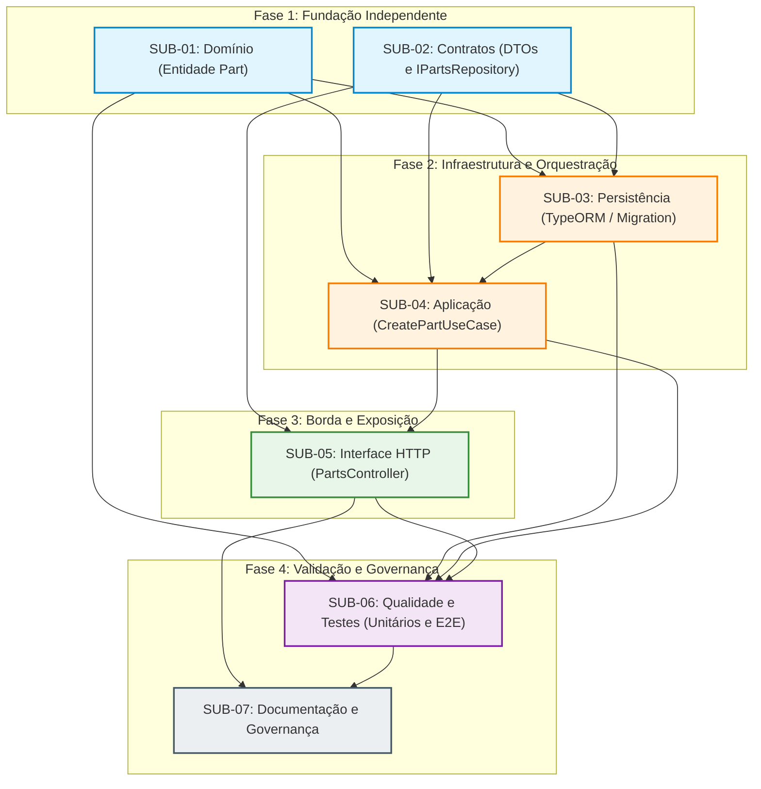

# Artefato 6 — Matriz de Dependências

## 1. Mapeamento de Interdependências Técnicas
A execução do caso de uso **`[UC12] Cadastrar Peça`** obedece aos limites arquiteturais da Clean Architecture. Diferentemente de uma abordagem monolítica desordenada, as atividades possuem pré-requisitos bem estabelecidos decorrentes de contratos de interface e de fluxo de dados.

A tabela a seguir discrimina cada relação de dependência, justificativa e potencial de paralelismo.

---

## 2. Tabela de Interdependências

| Atividade Técnica | Depende de (Pré-Requisito) | Justificativa Técnica da Dependência | Condição de Desbloqueio | Paralelizável? |
| :--- | :--- | :--- | :--- | :--- |
| **SUB-01** (Domínio / `Part`) | *Nenhuma* | O núcleo do domínio é puro e independente de frameworks, banco de dados ou transporte. | Imediatamente desbloqueada para início. | **Sim** (Pode iniciar em paralelo com SUB-02). |
| **SUB-02** (Contratos / DTOs e Porta) | *Nenhuma* (ou referencial leve a SUB-01) | Define o schema dos dados de borda e a assinatura da porta `IPartsRepository`. | Imediatamente desbloqueada para início. | **Sim** (Pode ser desenvolvida em paralelo com SUB-01). |
| **SUB-03** (Persistência / TypeORM) | **SUB-01**, **SUB-02** | O mapeamento relacional (`PartOrmEntity` e `PartMapper`) e a implementação do repositório dependem de conhecer a entidade `Part` e o contrato `IPartsRepository`. | Entidade `Part` compilando e interface `IPartsRepository` formalizada. | **Não** (Depende da estabilização do domínio e do contrato da porta). |
| **SUB-04** (Aplicação / `CreatePartUseCase`) | **SUB-01**, **SUB-02**, **SUB-03** | O serviço de aplicação orquestra a chamada de domínio e delega a gravação à porta de persistência. Pode iniciar com mock de repositório após SUB-01 e SUB-02, mas a integração exige SUB-03. | Contratos estabelecidos e assinatura do repositório disponível. | **Parcialmente** (A lógica do caso de uso com repositório em memória pode ser adiantada antes de SUB-03). |
| **SUB-05** (Interface HTTP / Controller) | **SUB-02**, **SUB-04** | O `PartsController` recebe o `CreatePartDto` (SUB-02) e invoca os métodos do `CreatePartUseCase` (SUB-04). | DTO de entrada finalizado e caso de uso disponível para injeção de dependência. | **Não** (Exige a porta de entrada da aplicação). |
| **SUB-06** (Qualidade / Testes E2E) | **SUB-01**, **SUB-02**, **SUB-03**, **SUB-04**, **SUB-05** | Testes de ponta a ponta (E2E) exigem toda a cadeia integrada operacional: Controller $\rightarrow$ UseCase $\rightarrow$ Repository $\rightarrow$ PostgreSQL. | Todas as camadas produtivas de código implementadas e integradas. | **Não** (Os testes E2E consolidam a validação final da esteira). |
| **SUB-07** (Documentação / Governança) | **SUB-05**, **SUB-06** | A documentação pública (Swagger/OpenAPI e README) reflete o comportamento consolidado e comprovado pelos testes de regressão. | Endpoint HTTP funcional e testes E2E aprovados. | **Não** (Atividade final de fechamento e auditoria do slice). |

---

## 3. Diagrama Visual de Dependências (Mermaid)

---

## 4. Análise do Caminho Crítico (Critical Path)
* **Caminho Crítico Principal:**
  $$\text{SUB-01 / SUB-02} \longrightarrow \text{SUB-03} \longrightarrow \text{SUB-04} \longrightarrow \text{SUB-05} \longrightarrow \text{SUB-06} \longrightarrow \text{SUB-07}$$
* **Impacto Operacional:** Qualquer atraso na definição da entidade `Part` (SUB-01) ou do contrato do repositório (SUB-02) propaga-se diretamente para a persistência e o serviço de aplicação. O início imediato e em paralelo de SUB-01 e SUB-02 é a estratégia recomendada para maximizar a vazão da equipe.

