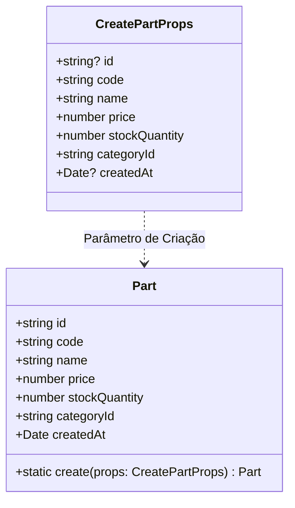

# Artefato 05-03 — Plano de Implementação GREEN

## 1. Objetivo Técnico da Implementação

Implementar estritamente o comportamento mínimo de produção na fábrica de domínio `Part.create(props: CreatePartProps)` para satisfazer todas as asserções do teste unitário `part.entity.spec.ts` (critério CA-01 da Sub-Issue `#6`), garantindo transição legítima da fase RED para a fase GREEN sem introduzir complexidade desnecessária ou lógica fora de escopo.

---

## 2. Análise Estrutural do Teste Alvo

O teste automatizado estabelece as seguintes expectativas sobre o comportamento da entidade:

1. **Entradas (Input):**
   * `props: CreatePartProps` contendo `code`, `name`, `price`, `stockQuantity`, `categoryId` e campos opcionais (`id`, `createdAt`).
2. **Operação Disparada (Act):**
   * Chamada ao método estático `Part.create(validProps)`.
3. **Saídas e Asserções Esperadas (Assert):**
   * `part !== undefined`
   * `part.id !== undefined && typeof part.id === 'string' && part.id.length > 0`
   * `part.code === validProps.code`
   * `part.name === validProps.name`
   * `part.price === validProps.price`
   * `part.stockQuantity === validProps.stockQuantity`
   * `part.categoryId === validProps.categoryId`
   * `part.createdAt instanceof Date`

---

## 3. Mapeamento de Componentes e Responsabilidades Arquiteturais

* **Camada:** Domínio Puro (`src/modules/parts/domain/`).
* **Responsabilidade:** Representar a entidade de negócio `Part`, garantindo que toda instância criada possua um identificador válido e um registro de data/hora de criação, além dos atributos de catálogo da peça.
* **Isolamento de Dependências:** Não há injeção de dependências de banco de dados, repositórios ou frameworks HTTP. Utiliza-se exclusivamente o utilitário nativo `randomUUID` de `node:crypto`.

---

## 4. Tabela do Plano de Alteração Técnica

| Arquivo | Componente / Classe | Responsabilidade Arquitetural | Estado Atual (RED) | Alteração Mínima Necessária (GREEN) | Critério de Aceite Coberto |
| :--- | :--- | :--- | :--- | :--- | :--- |
| `src/modules/parts/domain/part.entity.ts` | `Part.create` | Método estático de fábrica (*Domain Factory*) | Lança `Error('Method not implemented: Part.create')` | Instanciar `new Part()`, gerar UUID via `randomUUID()` se não fornecido, atribuir propriedades e atribuir `createdAt` (`Date`) | **CA-01** (Sub-Issue `#6`) |
| `src/modules/parts/domain/part.entity.ts` | Importação `node:crypto` | Módulo nativo de criptografia | Ausente | Importar `{ randomUUID } from 'node:crypto'` | **CA-01** |

---

## 5. Diretrizes de Implementação Mínima (Princípio TDD GREEN)

Para respeitar as regras capitais do TDD:
1. **O que SERÁ implementado:**
   - Atribuição direta dos campos recebidos via `props`;
   - Fallback de geração de UUID caso `props.id` seja indefinido;
   - Fallback de geração da data atual (`new Date()`) caso `props.createdAt` seja indefinido;
   - Retorno da instância preenchida.
2. **O que NÃO SERÁ implementado agora (adiado para REFACTOR / novos testes):**
   - Validações defensivas de strings vazias ou caracteres especiais (pertencem a novos testes);
   - Verificação de preço negativo ou estoque negativo (pertencem a testes dedicados para RN02 e RN03);
   - Mapeamento para entidades TypeORM / persistência de banco de dados (pertence à Sub-Issue `#8`);
   - Encapsulamento estrito com atributos privados e getters (pertence à fase REFACTOR - Material 06).

---

## 6. Critérios de Sucesso da Fase GREEN

* O comando `pnpm vitest run src/modules/parts/domain/part.entity.spec.ts` retorna exit code `0`.
* A suíte reporta `1 test passed (1)`.
* Tempo de execução inferior a 2 segundos em memória.
* Zero modificações nas asserções do teste original.
