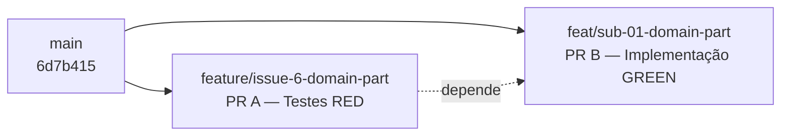

# Artefato 06-07 — Avaliação da Integração Controlada

## 1. Distinção Fundamental: Aprovação Técnica vs. Autorização para Merge

> **AVISO FUNDAMENTAL:**
> Ambos os Pull Requests foram **aprovados tecnicamente** (código limpo, testes passando, contratos íntegros).
> No entanto, **aprovação técnica NÃO é autorização para merge.** A integração à branch `main` requer análise formal dos critérios de integração abaixo e autorização explícita.

---

## 2. Os Quatro Estados Formais de Prontidão de um Pull Request

| Estado | Definição |
| :--- | :--- |
| **Estado A — Tecnicamente Revisado** | O PR passou por análise técnica e os relatórios foram emitidos |
| **Estado B — Aprovado Tecnicamente** | O PR foi aprovado por revisores; pendências resolvidas. **Não autoriza merge automaticamente** |
| **Estado C — Autorizado para Merge** | Todos os critérios de integração atendidos + autorização explícita |
| **Estado D — Integrado** | Merge efetivamente realizado e verificado |

---

## 3. Tabela de Avaliação dos 10 Critérios de Integração

### PR A — `feature/issue-6-domain-part` (Testes RED + Docs 04)

| # | Critério de Integração | Situação | Justificativa |
| :-: | :--- | :---: | :--- |
| 1 | **Escopo concluído** | ⚠️ Parcial | O contrato e o teste foram escritos; a implementação está em PR B |
| 2 | **Critérios de aceite satisfeitos** | ⚠️ Parcial | CA-01 especificado e testado; implementação dependente do PR B |
| 3 | **Testes automatizados passam** | ⚠️ Condicional | A branch isolada tem teste RED (falha intencional); unida ao PR B fica verde |
| 4 | **Verificações de qualidade** | ✅ | Sem erros de TypeScript ou Vitest no escopo da branch |
| 5 | **Revisão técnica concluída** | ✅ | Parecer técnico emitido (Artefato 06-05) |
| 6 | **Observações resolvidas** | ✅ | Nenhuma pendência bloqueante |
| 7 | **Branch-base correta** | ✅ | Base `main` — correto |
| 8 | **Ausência de conflitos** | ✅ | Merge-base identificado: `6d7b415` (sem conflitos conhecidos) |
| 9 | **Regras de proteção de branch** | ⚠️ N/A | Não há branch protection rules configuradas no repositório |
| 10 | **Autorização formal** | ❌ Pendente | Sem autorização explícita do responsável/professor |

**Estado Formal (PR A):** 🔵 **Estado B — Aprovado Tecnicamente**

**Decisão:** **B — Integração tecnicamente apta, aguardando autorização.** A branch está tecnicamente correta, mas o merge à `main` com testes RED (antes de PR B) deixaria a branch principal com falha deliberada — anti-padrão de engenharia. A integração mais segura é realizar o merge dos dois PRs de forma coordenada (PR A primeiro, depois PR B, ou squash de ambos).

---

### PR B — `feat/sub-01-domain-part` (Implementação GREEN + Docs 05)

| # | Critério de Integração | Situação | Justificativa |
| :-: | :--- | :---: | :--- |
| 1 | **Escopo concluído** | ✅ | CA-01 implementado e validado (entidade `Part.create`) |
| 2 | **Critérios de aceite satisfeitos** | ✅ | CA-01 comprovado; RN02/RN03 pertencem a ciclos futuros |
| 3 | **Testes automatizados passam** | ✅ | 1 passed + 6 passed (regressão) = zero falhas |
| 4 | **Verificações de qualidade** | ✅ | Vitest sem erros; TypeScript sem erros na camada de domínio |
| 5 | **Revisão técnica concluída** | ✅ | Parecer técnico emitido (Artefato 06-05) |
| 6 | **Observações resolvidas** | ✅ | Nenhuma pendência bloqueante |
| 7 | **Branch-base correta** | ✅ | Base `main` — correto |
| 8 | **Ausência de conflitos** | ✅ | Merge-base `6d7b415`; diff limpo |
| 9 | **Regras de proteção de branch** | ⚠️ N/A | Sem branch protection rules configuradas |
| 10 | **Autorização formal** | ❌ Pendente | Sem autorização explícita do responsável/professor |

**Estado Formal (PR B):** 🔵 **Estado B — Aprovado Tecnicamente**

**Decisão:** **B — Integração tecnicamente apta, aguardando autorização.** O código está pronto e aprovado. Aguarda autorização formal e encerramento completo dos critérios de aceite do UC12 nas Sub-Issues subsequentes (#7 a #12).

---

## 4. Análise da Cadeia de Branches Dependentes

**Estratégia de Integração Recomendada:**
1. **Opção 1 (Sequencial):** Merge PR A → `main`, depois rebase/atualiza PR B sobre a nova `main`, depois Merge PR B → `main`. Garante histórico limpo, mas deixa `main` temporariamente com teste RED.
2. **Opção 2 (Coordenada — Recomendada):** Merge PR B sobre PR A (ou squash), depois um único merge consolidado para `main` com testes sempre verdes.
3. **Opção 3 (Squash & Merge único):** Squash de todos os commits relevantes de ambas as branches em um único commit de feature para `main`, garantindo que a `main` só receba código verde.

> **Recomendação:** A **Opção 2 ou 3** preserva o princípio de **Green Main** — a branch principal nunca deve conter código com testes falhando deliberadamente.

---

## 5. Parecer Formal de Integração

| Pull Request | Decisão Formal | Justificativa |
| :--- | :---: | :--- |
| **PR A** (`feature/issue-6-domain-part`) | **Decisão B** | Aprovado tecnicamente; aguarda autorização formal e coordenação com PR B |
| **PR B** (`feat/sub-01-domain-part`) | **Decisão B** | Aprovado tecnicamente; aguarda autorização formal e Sub-Issues subsequentes |

**Merge NÃO executado.** Este é o resultado **correto e esperado** nesta etapa acadêmica: o UC12 ainda possui Sub-Issues `#7` a `#12` a serem desenvolvidas, e a integração prematura da branch parcial à `main` não representa boa prática de Engenharia de Software.

---

## 6. Próximas Ações

1. Manter os PRs como **Draft** até conclusão de Sub-Issues dependentes;
2. Avançar para o ciclo TDD da Sub-Issue `#7` (`[SUB-02]` — Value Objects e invariantes de domínio), que cobrirá RN02 e RN03;
3. Reavaliação dos critérios de integração após conclusão do escopo completo do UC12.
