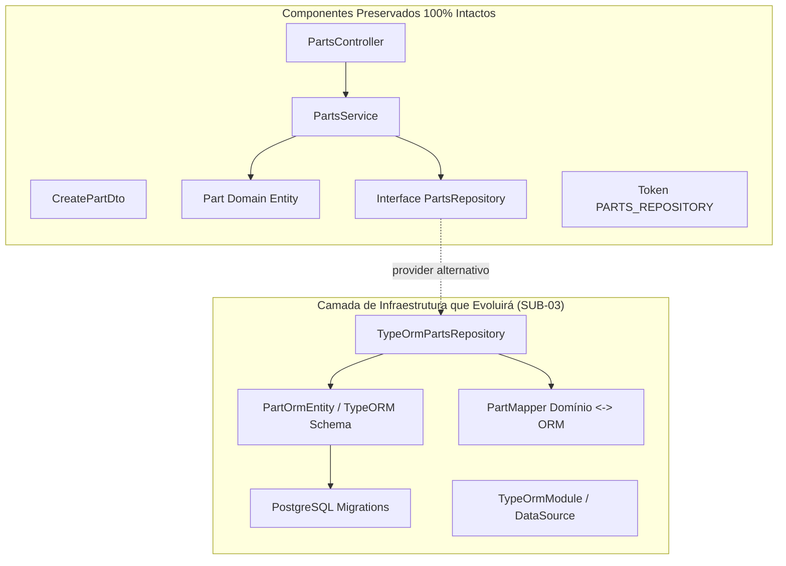

# Artefato 08-07 — Preparação Conceitual para Persistência Real

> ⛔ **AVISO DE ESCOPO:**
> Esta etapa constitui **análise arquitetural e planejamento conceitual**.
> Nenhuma implementação de banco PostgreSQL, TypeORM, Prisma, Docker ou migration foi antecipada nesta unidade, preservando a separação formal entre Sub-Issues.

---

## 1. Arquitetura Atual vs. Evolução Conceitual

Graças à aplicação rigorosa do **Princípio de Inversão de Dependência (DIP)** nas etapas anteriores, a arquitetura do AutoFlow permite substituir o repositório em memória por um repositório relacional sem modificar uma única linha de código do `PartsController`, do `PartsService` ou da entidade `Part`:

### Arquitetura Atual (Material 08):
```text
[PartsController] ──> [PartsService] ──> [PartsRepository (Token: PARTS_REPOSITORY)]
                                                │
                                                ▼
                                    [InMemoryPartsRepository] (Map em RAM)
```

### Evolução Futura (Material 09 / Sub-Issue #8):
```text
[PartsController] ──> [PartsService] ──> [PartsRepository (Token: PARTS_REPOSITORY)]
                                                │
                     ┌──────────────────────────┴──────────────────────────┐
                     ▼                                                     ▼
         [InMemoryPartsRepository]                             [TypeOrmPartsRepository]
          (Para testes unitários/CI)                           (Para ambiente de produção)
                                                                           │
                                                                           ▼
                                                                  [PostgreSQL Database]
```

---

## 2. Análise Detalhada das 6 Limitações da Persistência em Memória

| # | Limitação Técnica | Impacto no Projeto AutoFlow | Solução no Banco de Dados Real |
| :-: | :--- | :--- | :--- |
| **1** | **Volatilidade dos Dados** | Se o processo Node.js reiniciar ou o pod do Kubernetes for recriado, todas as peças cadastradas são perdidas imediatamente. | Gravação durável em disco com log de transações (*Write-Ahead Logging* / WAL do PostgreSQL). |
| **2** | **Escopo Restrito à Instância** | Se o backend for escalado horizontalmente (2 ou mais réplicas), cada instância terá seu próprio `Map` em RAM, gerando inconsistência de estoque. | Banco de dados centralizado acessado concorrentemente por todas as instâncias da API. |
| **3** | **Concorrência e Race Conditions** | Duas requisições simultâneas tentando cadastrar o mesmo SKU podem consultar o `Map` ao mesmo tempo e ambas passarem na verificação. | Nível de isolamento transacional (*Read Committed* / *Serializable*) e locks de linha/tabela. |
| **4** | **Ausência de Transações ACID** | Operações que exigem gravação em múltiplas tabelas (ex.: cadastrar peça e registrar movimentação de lote) não possuem garantia de rollback atômico. | Comandos nativos `BEGIN`, `COMMIT` e `ROLLBACK` gerenciados pelo SGBD. |
| **5** | **Falta de Constraints Nativas** | A unicidade do SKU é garantida apenas por um loop `for` em memória, sem garantia de integridade estrutural. | Constraints SQL declarativas: `UNIQUE(code)`, `CHECK(price > 0)`, `CHECK(stock_quantity >= 0)`. |
| **6** | **Inviabilidade para Auditoria** | Não há rastreabilidade de histórico, backups, replicação, índices B-Tree ou consultas analíticas em grande volume. | Recursos corporativos de SGBD (índices, triggers, replicação primário/réplica, backups PITR). |

---

## 3. Matriz de Componentes Preservados vs. Componentes que Evoluirão



---

## 4. Rastreabilidade com a Sub-Issue de Persistência

* **Sub-Issue Responsável no Planejamento:** [#8 — [SUB-03] feat(infra): implementar persistência TypeORM, PartOrmEntity e migration PostgreSQL](https://github.com/peaga21/AutoFlow/issues/8).
* **Estado Atual no Board:** Permanece como **`Backlog`** (ou `Ready` para início no Material 09).
* **Garantia de Não-Antecipação:** Nenhuma tabela foi criada no PostgreSQL e nenhuma migration foi rodada nesta unidade, mantendo o escopo estritamente delimitado e governado.
