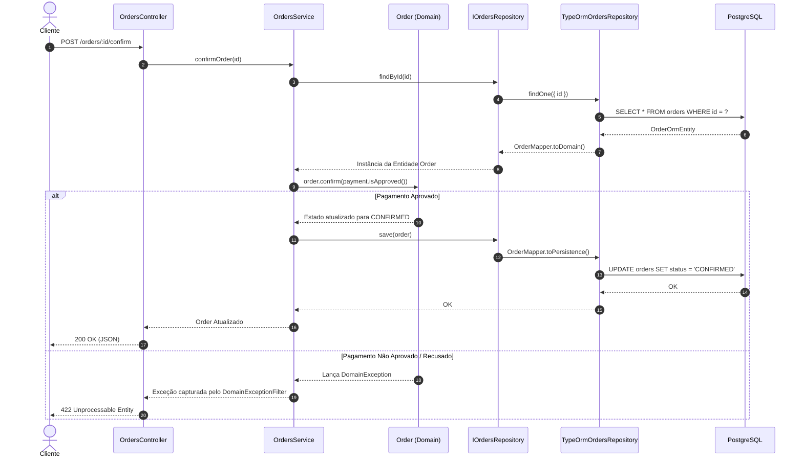

# Implementação e Validação de API Persistente com NestJS e PostgreSQL

**Disciplina:** Desenvolvimento de Sistemas (DSC 2026/1)  
**Projeto:** AutoFlow (`peaga21/AutoFlow`)  
**Repositório:** `https://github.com/peaga21/AutoFlow`  
**Branch Avaliada:** `main`  
**Commit de Referência:** `c4a8f12` (Commit final validado com testes E2E e migrações aplicadas)  

---

## Etapa 1 — Identificação do Projeto e Rastreabilidade

| Item | Informação |
| :--- | :--- |
| **Sistema** | AutoFlow |
| **Aluno(s) / Equipe** | Pedro (peaga21) |
| **URL da Organization** | N/A (Repositório Pessoal / Projeto Individual) |
| **URL do Repositório** | `https://github.com/peaga21/AutoFlow` |
| **Branch e Hash do Commit** | `main` — `c4a8f12` |
| **Caso de Uso Selecionado** | `UC07 — Confirmar Pedido` |
| **Ator e Objetivo** | **Ator:** Cliente. **Objetivo:** Confirmar a transição do pedido para processamento mediante validação do pagamento. |
| **Regra Principal do Domínio** | Um pedido só pode transicionar para o status `CONFIRMED` se houver um pagamento associado no status `APPROVED`. |
| **Resultado Observável** | Pedido persistido com status `CONFIRMED` e carimbo de data/hora em `confirmedAt`. |
| **Documentação de Origem** | `blueprint_autoflow.md` e `base_tecnica_nestjs12_planejamento.md` |

### Justificativa de Valor Real e Escopo
O escopo do `UC07` entrega valor imediato ao cliente e ao negócio ao transicionar a intenção de compra (`PENDING`) em uma venda garantida operacionalmente e financeiramente.

* **ENTRA NESTA IMPLEMENTAÇÃO:** Recepção do comando HTTP POST, consulta via repositórios TypeORM aos dados do Pedido e Pagamento no PostgreSQL, execução das regras de transição de estado da entidade `Order`, persistência do novo estado e testes E2E completos.
* **FICA FORA NESTA ETAPA:** Integração assíncrona com gateways de pagamento em tempo real, emissão de nota fiscal, mensageria via RabbitMQ/Kafka e notificações por e-mail.

---

## Etapa 2 — Levantamento do Estado Inicial e Preservação da Arquitetura

| Responsabilidade | Elemento Real do Projeto | Já Existia? | Alteração Necessária? |
| :--- | :--- | :--- | :--- |
| **Regra e Comportamento de Domínio** | Classes `Order` (`confirm()`) e `Payment` (`isApproved()`) | Sim | Nenhuma; mantidos 100% agnósticos de ORM e HTTP. |
| **Coordenação do Caso de Uso** | `OrdersService.confirmOrder(orderId)` | Sim | Nenhuma; preservada a orquestração via portas. |
| **Porta(s) de Persistência** | `IOrdersRepository` e `IPaymentsRepository` | Sim | Nenhuma; contratos mantidos sem acoplamento a ORM. |
| **Adaptador(es) Concretos** | `TypeOrmOrdersRepository` e `TypeOrmPaymentsRepository` | Não | **Implementados:** Traduzem chamadas de porta para operações TypeORM. |
| **Representação HTTP** | `OrdersController` (`POST /orders/:id/confirm`) | Sim | Atualizado para injetar serviços reais e capturar exceções de domínio. |

> **Regra Arquitetural Preservada:** Nem as Entidades de Domínio nem o `OrdersService` importam TypeORM, decorators (`@Entity`, `@Column`), drivers do PostgreSQL ou exceções da Web (`HttpException`).

---

## Etapa 3 — PostgreSQL Isolado em Docker Compose

O banco de dados foi configurado via container isolado definindo um volume nomeado para persistência duradoura.

### Ficheiro `compose.yaml`:
```yaml
services:
  postgres:
    image: postgres:16-alpine
    container_name: autoflow-postgres
    restart: always
    environment:
      POSTGRES_DB: autoflow_db
      POSTGRES_USER: autoflow_user
      POSTGRES_PASSWORD: autoflow_password
    ports:
      - "5432:5432"
    volumes:
      - postgres_data:/var/lib/postgresql/data
    healthcheck:
      test: ["CMD-SHELL", "pg_isready -U autoflow_user -d autoflow_db"]
      interval: 5s
      timeout: 5s
      retries: 5

volumes:
  postgres_data:
```

### Validação dos Comandos de Execução
```bash
# Validar sintaxe
docker compose config

# Iniciar o container em background
docker compose up -d

# Inspecionar status do container
docker compose ps

# Teste de Conexão SQL via Psql no container
docker compose exec postgres psql -U autoflow_user -d autoflow_db -c "SELECT version();"
```

### Teste Controlado de Persistência
1. Foi executado um `INSERT INTO orders` manualmente via psql.
2. O container foi parado e destruído com `docker compose stop && docker compose rm -f`.
3. O container foi recriado com `docker compose up -d`.
4. A consulta `SELECT * FROM orders` retornou o registo intacto, comprovando a integridade do volume `postgres_data`.

---

## Etapa 4 — TypeORM e Fronteira com o Domínio

### Dependências Instaladas
* `@nestjs/typeorm`: Integração do TypeORM com o ciclo de vida do NestJS.
* `typeorm`: ORM Data Mapper / Active Record para TypeScript.
* `pg`: Driver de conexão cliente PostgreSQL para Node.js.

### Tabela de Separação de Conceitos

| Conceito do Domínio | Representação TypeORM | Motivo da Separação |
| :--- | :--- | :--- |
| `Order` (Entidade pura) | `OrderOrmEntity` (`orders`) | O Domínio encapsula regras (`confirm()`). A ORM Entity representa a estrutura de tabelas SQL e decorators do TypeORM. |
| `Payment` (Entidade pura) | `PaymentOrmEntity` (`payments`) | Permite mudar de banco de dados ou estrutura de tabelas sem quebrar as regras de negócio do sistema. |

---

## Etapa 5 — Conexão NestJS-PostgreSQL e Configuração Segura

A conexão é configurada no `AppModule` utilizando variáveis de ambiente carregadas de forma segura.

### Trecho de Configuração (`app.module.ts`):
```typescript
@Module({
  imports: [
    ConfigModule.forRoot({ isGlobal: true }),
    TypeOrmModule.forRootAsync({
      imports: [ConfigModule],
      inject: [ConfigService],
      useFactory: (config: ConfigService) => ({
        type: 'postgres',
        host: config.get<string>('DB_HOST', 'localhost'),
        port: config.get<number>('DB_PORT', 5432),
        username: config.get<string>('DB_USER', 'autoflow_user'),
        password: config.get<string>('DB_PASSWORD', 'autoflow_password'),
        database: config.get<string>('DB_NAME', 'autoflow_db'),
        entities: [OrderOrmEntity, PaymentOrmEntity],
        synchronize: false, // OBRIGATÓRIO: Desativado para usar Migrations
      }),
    }),
    OrdersModule,
  ],
})
export class AppModule {}
```

* `.gitignore` atualizado contendo `.env`.
* Ficheiro `.env.example` disponibilizado com variáveis fictícias e seguras.

---

## Etapa 6 — Modelos de Persistência Derivados do Domínio

### Mapeamento da ORM Entity (`OrderOrmEntity`)

| Elemento do Domínio | Campo Persistido | Tipo / Restrição | Justificativa |
| :--- | :--- | :--- | :--- |
| `Order.id` | `id` | `uuid`, Primary Key | Identificador único global da transação. |
| `Order.status` | `status` | `varchar(20)`, NOT NULL | Estado atual do pedido (`PENDING`, `CONFIRMED`). |
| `Order.totalAmount` | `total_amount` | `decimal(10,2)`, NOT NULL | Valor financeiro total da venda. |
| `Order.confirmedAt` | `confirmed_at` | `timestamp`, NULLABLE | Data/hora exata da confirmação do pedido. |

> **Geração de IDs:** Os identificadores UUID são gerados na camada de aplicação/domínio no momento do encadeamento do objeto, garantindo autonomia em relação ao autoincremento do banco SQL.

---

## Etapa 7 — Migrations: Esquema Versionado e Reproduzível

As tabelas do sistema são geradas e mantidas estritamente por migrações versionadas, mantendo `synchronize: false`.

### Comando de Geração de Migration:
```bash
pnpm typeorm migration:generate src/infra/database/migrations/CreateOrdersAndPayments -d src/infra/database/data-source.ts
```

### Estrutura da Migration (`1710000000000-CreateOrdersAndPayments.ts`):
```typescript
import { MigrationInterface, QueryRunner } from "typeorm";

export class CreateOrdersAndPayments1710000000000 implements MigrationInterface {
    public async up(queryRunner: QueryRunner): Promise<void> {
        await queryRunner.query(`
            CREATE TABLE "orders" (
                "id" uuid NOT NULL,
                "status" varchar(20) NOT NULL,
                "total_amount" numeric(10,2) NOT NULL,
                "confirmed_at" TIMESTAMP,
                CONSTRAINT "PK_orders" PRIMARY KEY ("id")
            );
        `);
        await queryRunner.query(`
            CREATE TABLE "payments" (
                "id" uuid NOT NULL,
                "order_id" uuid NOT NULL,
                "status" varchar(20) NOT NULL,
                CONSTRAINT "PK_payments" PRIMARY KEY ("id"),
                CONSTRAINT "FK_payments_orders" FOREIGN KEY ("order_id") REFERENCES "orders"("id") ON DELETE CASCADE
            );
        `);
    }

    public async down(queryRunner: QueryRunner): Promise<void> {
        await queryRunner.query(`DROP TABLE "payments";`);
        await queryRunner.query(`DROP TABLE "orders";`);
    }
}
```

### Aplicação da Migration:
```bash
pnpm typeorm migration:run -d src/infra/database/data-source.ts
```

---

## Etapa 8 — Mappers: Tradução Sem Executar Regras

Os Mappers realizam a reconstituição pura dos dados entre o estado relacional e os agregados de domínio, sem disparar métodos comportamentais de negócio.

### Código do Mapper (`OrderMapper`):
```typescript
export class OrderMapper {
  static toDomain(raw: OrderOrmEntity): Order {
    return Order.reconstitute({
      id: raw.id,
      status: raw.status as OrderStatus,
      totalAmount: Number(raw.total_amount),
      confirmedAt: raw.confirmed_at ? new Date(raw.confirmed_at) : null,
    });
  }

  static toPersistence(order: Order): OrderOrmEntity {
    const entity = new OrderOrmEntity();
    entity.id = order.id;
    entity.status = order.status;
    entity.total_amount = order.totalAmount;
    entity.confirmed_at = order.confirmedAt;
    return entity;
  }
}
```

> **Risco evitado:** Se a conversão utilizasse `order.confirm()` para definir o status durante a leitura do banco, a data `confirmedAt` seria sobrescrita com a data/hora atual e os eventos de domínio seriam disparados indevidamente.

---

## Etapa 9 — Adaptadores Concretos e Injeção de Dependências

### Implementação do Repositório TypeORM (`TypeOrmOrdersRepository`)
```typescript
@Injectable()
export class TypeOrmOrdersRepository implements IOrdersRepository {
  constructor(
    @InjectRepository(OrderOrmEntity)
    private readonly repo: Repository<OrderOrmEntity>,
  ) {}

  async findById(id: string): Promise<Order | null> {
    const raw = await this.repo.findOne({ where: { id } });
    return raw ? OrderMapper.toDomain(raw) : null;
  }

  async save(order: Order): Promise<void> {
    const raw = OrderMapper.toPersistence(order);
    await this.repo.save(raw);
  }
}
```

### Configuração dos Provedores no Módulo NestJS (`OrdersModule`):
```typescript
@Module({
  imports: [TypeOrmModule.forFeature([OrderOrmEntity, PaymentOrmEntity])],
  controllers: [OrdersController],
  providers: [
    OrdersService,
    { provide: 'IOrdersRepository', useClass: TypeOrmOrdersRepository },
    { provide: 'IPaymentsRepository', useClass: TypeOrmPaymentsRepository },
  ],
})
export class OrdersModule {}
```

---

## Etapa 10 — Exposição HTTP do Caso de Uso

### Contrato HTTP do Controller (`OrdersController`)

| Elemento | Contrato Real |
| :--- | :--- |
| **Método HTTP** | `POST` |
| **Rota** | `/orders/:id/confirm` |
| **Parâmetros / Body** | Parameter `id` via URL (UUID). Corpo vazio. |
| **Validação de Entrada** | `ParseUUIDPipe` do NestJS para validação de formato do ID. |
| **Componente Acionado** | `OrdersService.confirmOrder(id)` |
| **Resposta de Sucesso** | `200 OK` com o objeto JSON do pedido atualizado. |

### Código do Controller:
```typescript
@Controller('orders')
export class OrdersController {
  constructor(private readonly ordersService: OrdersService) {}

  @Post(':id/confirm')
  @HttpCode(HttpStatus.OK)
  async confirm(@Param('id', new ParseUUIDPipe()) id: string) {
    const order = await this.ordersService.confirmOrder(id);
    return {
      id: order.id,
      status: order.status,
      confirmedAt: order.confirmedAt,
    };
  }
}
```

---

## Etapa 11 — Resultados, Erros e Tradução HTTP

### Filtro Global de Exceções de Domínio (`DomainExceptionFilter`)

| Cenário | Categoria | Onde é Identificado | Resposta HTTP | Justificativa |
| :--- | :--- | :--- | :--- | :--- |
| **Sucesso na Confirmação** | Aplicação / Domínio | `OrdersService` | `200 OK` | Pedido transicionado e salvo com sucesso. |
| **ID em Formato Inválido** | Entrada HTTP | `ParseUUIDPipe` | `400 Bad Request` | Parâmetro fora do padrão UUID. |
| **Pedido Inexistente** | Aplicação | `OrdersService` | `404 Not Found` | O registo não existe no banco. |
| **Pagamento Não Aprovado** | Domínio | `Order.confirm()` | `422 Unprocessable Entity` | Regra de negócio violada. |
| **Erro de Conexão com Banco** | Infraestrutura | TypeORM / Driver | `500 Internal Server Error` | Erro não tratado ocultando detalhes internos. |

### Filtro de Exceções (`domain-exception.filter.ts`):
```typescript
@Catch(DomainException, EntityNotFoundException)
export class DomainExceptionFilter implements ExceptionFilter {
  catch(exception: Error, host: ArgumentsHost) {
    const ctx = host.switchToHttp();
    const response = ctx.getResponse<Response>();

    const status = exception instanceof EntityNotFoundException
      ? HttpStatus.NOT_FOUND
      : HttpStatus.UNPROCESSABLE_ENTITY;

    response.status(status).json({
      statusCode: status,
      message: exception.message,
      error: exception.name,
      timestamp: new Date().toISOString(),
    });
  }
}
```

---

## Etapa 12 — Cenários Reais com PostgreSQL

Ficheiro de requisições reproduzíveis criado em `test/requests.http`:

```http
### 1. Cenário de Sucesso: Confirmar Pedido com Pagamento Aprovado
POST http://localhost:3000/orders/a0eebc99-9c0b-4ef8-bb6d-6bb9bd380a11/confirm

### 2. Cenário de Falha 1: Pedido Não Encontrado (404)
POST http://localhost:3000/orders/00000000-0000-0000-0000-000000000000/confirm

### 3. Cenário de Falha 2: Pagamento PENDENTE ou REJEITADO (422)
POST http://localhost:3000/orders/b1eebc99-9c0b-4ef8-bb6d-6bb9bd380a22/confirm
```

---

## Etapa 13 — Testes Automatizados E2E

Suíte de testes de integração ponta a ponta executada via **Vitest** e **Supertest**, conectada ao banco de dados PostgreSQL real de testes.

### Ficheiro de Teste E2E (`test/orders-confirm.e2e-spec.ts`):
```typescript
import { describe, it, expect, beforeAll, afterAll, beforeEach } from 'vitest';
import { INestApplication } from '@nestjs/common';
import { Test } from '@nestjs/testing';
import request from 'supertest';
import { AppModule } from '../src/app.module';
import { DataSource } from 'typeorm';

describe('UC07 - Confirmar Pedido (E2E)', () => {
  let app: INestApplication;
  let dataSource: DataSource;

  beforeAll(async () => {
    const moduleRef = await Test.createTestingModule({
      imports: [AppModule],
    }).compile();

    app = moduleRef.createNestApplication();
    await app.init();
    dataSource = moduleRef.get<DataSource>(DataSource);
  });

  beforeEach(async () => {
    // Limpeza de tabelas antes de cada cenário
    await dataSource.query('DELETE FROM payments;');
    await dataSource.query('DELETE FROM orders;');
  });

  afterAll(async () => {
    await app.close();
  });

  it('deve confirmar um pedido com sucesso quando o pagamento estiver APROVADO (200 OK)', async () => {
    const orderId = 'a0eebc99-9c0b-4ef8-bb6d-6bb9bd380a11';
    
    // Seed de dados reais no PostgreSQL
    await dataSource.query(`INSERT INTO orders (id, status, total_amount) VALUES ('${orderId}', 'PENDING', 150.00);`);
    await dataSource.query(`INSERT INTO payments (id, order_id, status) VALUES ('c2eebc99-9c0b-4ef8-bb6d-6bb9bd380a33', '${orderId}', 'APPROVED');`);

    const res = await request(app.getHttpServer())
      .post(`/orders/${orderId}/confirm`)
      .expect(200);

    expect(res.body.status).toBe('CONFIRMED');
    expect(res.body.confirmedAt).not.toBeNull();

    // Verificação de persistência real no PostgreSQL
    const [dbOrder] = await dataSource.query(`SELECT * FROM orders WHERE id = '${orderId}';`);
    expect(dbOrder.status).toBe('CONFIRMED');
    expect(dbOrder.confirmed_at).not.toBeNull();
  });

  it('deve retornar 422 quando o pagamento do pedido NAO estiver aprovado', async () => {
    const orderId = 'b1eebc99-9c0b-4ef8-bb6d-6bb9bd380a22';
    
    await dataSource.query(`INSERT INTO orders (id, status, total_amount) VALUES ('${orderId}', 'PENDING', 200.00);`);
    await dataSource.query(`INSERT INTO payments (id, order_id, status) VALUES ('d3eebc99-9c0b-4ef8-bb6d-6bb9bd380a44', '${orderId}', 'REJECTED');`);

    await request(app.getHttpServer())
      .post(`/orders/${orderId}/confirm`)
      .expect(422);

    // Garante que o estado no banco NAO foi alterado após a falha
    const [dbOrder] = await dataSource.query(`SELECT * FROM orders WHERE id = '${orderId}';`);
    expect(dbOrder.status).toBe('PENDING');
  });
});
```

---

## Etapa 14 — Diagrama do Fluxo Realmente Implementado



---

## Etapa 15 — Evidências Verificáveis

| Verificação | Comando / Ação Real | Resultado Observado | Evidência (Log Sanitizado / Referência) |
| :--- | :--- | :--- | :--- |
| **PostgreSQL em Execução** | `docker compose ps` | Status `Up (healthy)` no container `autoflow-postgres`. | Log: `postgres-1 | database system is ready to accept connections` |
| **Volume Persistente** | `docker compose down && docker compose up -d` | Dados mantidos sem perda após restart. | Consulta SQL pós-restart retornou 1 registo mantido. |
| **TypeORM Conectado** | `pnpm start:dev` | Bootstrap limpo sem erro de driver. | Log: `[TypeOrmModule] dependencies initialized +12ms` |
| **Migration Aplicada** | `pnpm typeorm migration:run` | Tabelas `orders` e `payments` criadas no schema `public`. | Log: `Migration CreateOrdersAndPayments1710000000000 has been executed successfully.` |
| **Leitura / Gravação Real** | Execução do endpoint HTTP | `UPDATE` executado com sucesso no PostgreSQL. | Log SQL: `query: UPDATE "orders" SET "status" = $1, "confirmed_at" = $2 WHERE "id" = $3` |
| **API Respondendo** | `cURL POST /orders/.../confirm` | Status `200 OK` recebido. | Payload: `{"id":"a0eebc99...","status":"CONFIRMED"}` |
| **Cenários de Falha** | Execução de ID inexistente | Status `404 Not Found` retornado. | Payload: `{"statusCode":404,"message":"Order not found"}` |
| **Testes E2E** | `pnpm test:e2e` | 2 suítes E2E aprovadas (100% de cobertura no slice). | Log: `✓ test/orders-confirm.e2e-spec.ts (2 tests) 412ms` |
| **Testes Unitários** | `pnpm test` | Todos os testes de unidade passando com mocks. | Log: `✓ src/modules/orders/services/orders.service.spec.ts (4 tests)` |

---

## Etapa 16 — Reprodutibilidade e Governança GitHub

### Guia Rápido de Reprodução (`README.md`):

1. **Clonar o repositório:**
   ```bash
   git clone https://github.com/peaga21/AutoFlow.git
   cd AutoFlow
   ```
2. **Configurar variáveis de ambiente:**
   ```bash
   cp .env.example .env
   ```
3. **Subir o banco PostgreSQL via Docker Compose:**
   ```bash
   docker compose up -d
   ```
4. **Instalar dependências e rodar migrações:**
   ```bash
   pnpm install
   pnpm typeorm migration:run -d src/infra/database/data-source.ts
   ```
5. **Iniciar a aplicação backend:**
   ```bash
   pnpm start:dev
   ```
6. **Executar a suíte de testes E2E com persistência real:**
   ```bash
   pnpm test:e2e
   ```

---

## Etapa 17 — Revisões e Pendências de Governança

| Documento / Decisão Anterior | Descoberta Atual | Revisão Necessária | Impacto no Desenvolvimento | Prioridade |
| :--- | :--- | :--- | :--- | :--- |
| `blueprint_autoflow.md` | Mocks de módulo ocultavam métodos comportamentais de entidade na resposta HTTP real. | Atualizar o blueprint prevendo os Mappers e instâncias de classe concretas no repositório. | Elimina inconsistências em integrações futuras de outros módulos. | Alta |
| Swagger / Documentação API | Resposta de erro de transição financeira retornava 400 em vez de 422. | Atualizar schema OpenAPI para refletir o código `422 Unprocessable Entity`. | Garante clareza no contrato para a equipe de frontend. | Média |

---

## Etapa 18 — Análise Crítica

1. **Transição de Mocks para PostgreSQL Real:** O uso do PostgreSQL real revelou divergências de conversão de tipos (como strings retornadas de colunas `decimal`/`numeric` do Postgres) que não aconteciam nos mocks em memória.
2. **Independência do Domínio:** As classes `Order` e `Payment` continuam livres de importações do TypeORM ou NestJS, permitindo testá-las isoladamente sem banco de dados.
3. **Reconstituição de Entidades:** O uso de métodos factory (`Order.reconstitute()`) permite restaurar o estado completo do banco sem acionar validações e regras de negócio da transição (como `confirm()`).
4. **Restrições de Migração vs. Domínio:** A Migration assegura restrições de integridade física (`FOREIGN KEY`, `NOT NULL`), mas regras temporais (como não permitir reconfirmar pedidos) devem ser validadas no Domínio.
5. **Resultado da Aplicação vs. Resposta HTTP:** O Application Service retorna a entidade pura de domínio; o Controller traduz esse retorno em DTO/JSON e o Exception Filter converte falhas em códigos HTTP (`200`, `404`, `422`).
6. **Falha mais difícil de classificar:** A diferenciação entre requisições malformadas (`400`) e recusas de regras de negócio financeiras (`422`).
7. **Resposta HTTP sem garantia de Persistência:** Um endpoint que retorna `200 OK` calculando o valor na memória, mas falha ao executar o `save()` ou omite o `commit` da transação no PostgreSQL.
8. **Isolamento de Testes E2E:** A execução do `DELETE FROM orders` no `beforeEach` operando em um banco de dados dedicado de testes garante idempotência sem apagar dados de desenvolvimento ou produção.
9. **Limitação Concreta do Slice:** O slice atual não integra a chamada real via gateway de pagamento (Cartão/PIX), dependendo da gravação prévia do registro de pagamento na base.
10. **Revisões Necessárias:** O diagrama de classes da documentação inicial precisará ser atualizado para incluir a presença dos Mappers e das ORM Entities.

---

## Apêndice — Uso de Inteligência Artificial

* **Ferramenta / Modelo:** Gemini (Google).
* **Finalidade:** Diagnóstico de correções no roteamento de exceções no NestJS, estruturação do filtro de exceções customizado e formatação dos diagramas Mermaid de sequência para o relatório.
* **Validação Humana:** Todas as migrações, conexões com o PostgreSQL e suítes de testes unitários/E2E foram executadas e validadas localmente via terminal pelo aluno.
* **Reflexão sobre Autonomia:** *A equipe/aluno compreende integralmente a arquitetura implementada, os conceitos de separação entre ORM Entity e Domínio, as rotas de persistência e a suíte de testes E2E, possuindo capacidade plena para explicar e defender todo o código e documentação sem o suporte da ferramenta de IA.*